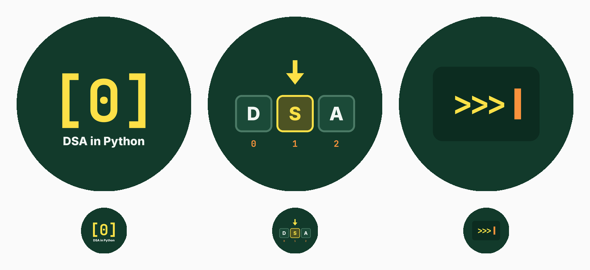

# Profile picture and bio

## Profile picture



| File | Idea | Verdict |
|---|---|---|
| `avatar_b_dsa_cells.png` | The letters D S A as list cells, with the middle one highlighted under the pointer arrow and indices 0 1 2 below. It's the exact visual language of the Reels. | **Recommended.** Reads clearly at feed size and says "data structures" at a glance. |
| `avatar_a_index_zero.png` | `[0]`, the "counting starts at zero" idea from Episode 01 | Strong and simple. The text under it is too small to read in the feed, so drop it if you choose this one. |
| `avatar_c_repl_prompt.png` | A `>>>` Python prompt with a blinking caret | Clean, but says "Python" more than "DSA". |

All three are 1080 × 1080 in the videos' dark green and yellow. They're original
artwork and don't use the Python logo, whose use in logos is restricted by the
Python Software Foundation's trademark policy. Regenerate them after any colour
change with `python branding/make_avatars.py`.

## Name field (searchable, up to 64 characters)

`DSA in Python | Animated Coding`

Instagram search matches the **name** field as well as the handle, so put the keywords there.

## Bio (each one is under 150 characters)

**Option 1: clear and keyword-rich (recommended)**
```
🐍 Python data structures & algorithms, animated
📦 Lists → arrays → trees → graphs
🧠 One concept in under a minute
👇 Start with Ep 01
```

**Option 2: interview angle**
```
Learn DSA by watching it move 🎬
🐍 Python · data structures · algorithms
🎯 For CS students & coding interviews
New episode every week 👇
```

**Option 3: playful, coder-style**
```
Python DSA, visualised 🐍
[0] → [n-1]: lists to graphs, step by step
💬 Quiz in every caption, answer pinned
👇 Episode 01
```

## Profile setup checklist

- [ ] Switch to a **Creator** account to get insights and the "Education" or "Digital creator" category label
- [ ] **Pin** Reels 01–03 to the top of the grid, so new visitors start at the beginning
- [ ] Make a **Highlight** per season ("Lists", "Collections", "Linked lists", …), with covers in the same dark green
- [ ] Link: optional. A free link-in-bio page or a GitHub repo with the episode code works well for CS students.
- [ ] Use the same handle in the videos: replace `@yourhandle` in `engine/episodes/common.py` and `ep01_list_indexing.py`, then re-render
