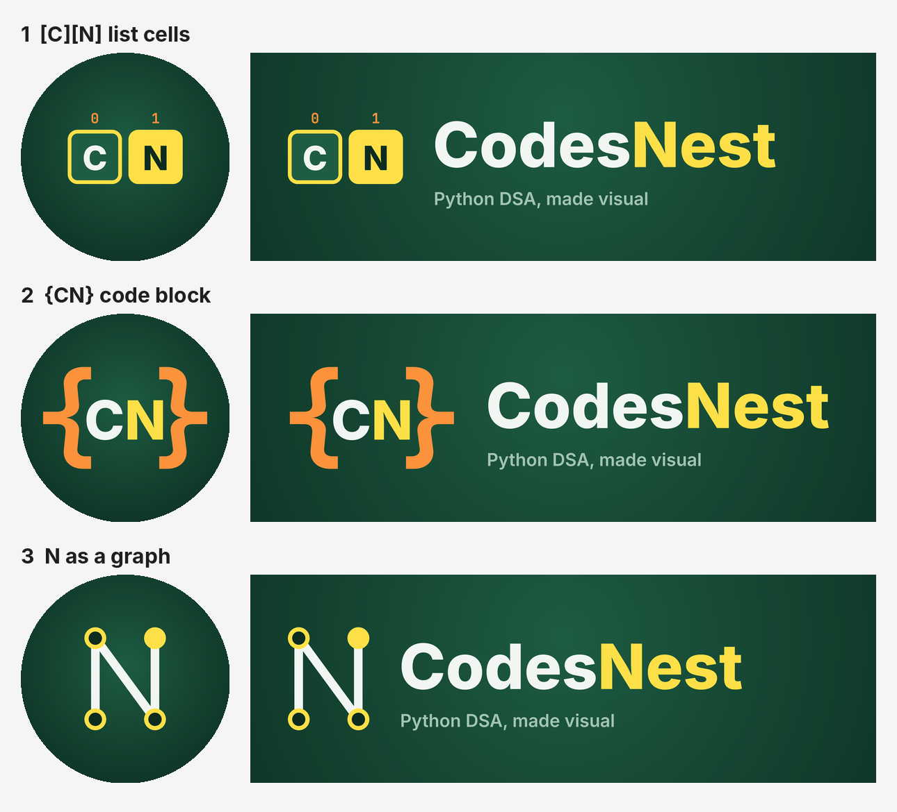
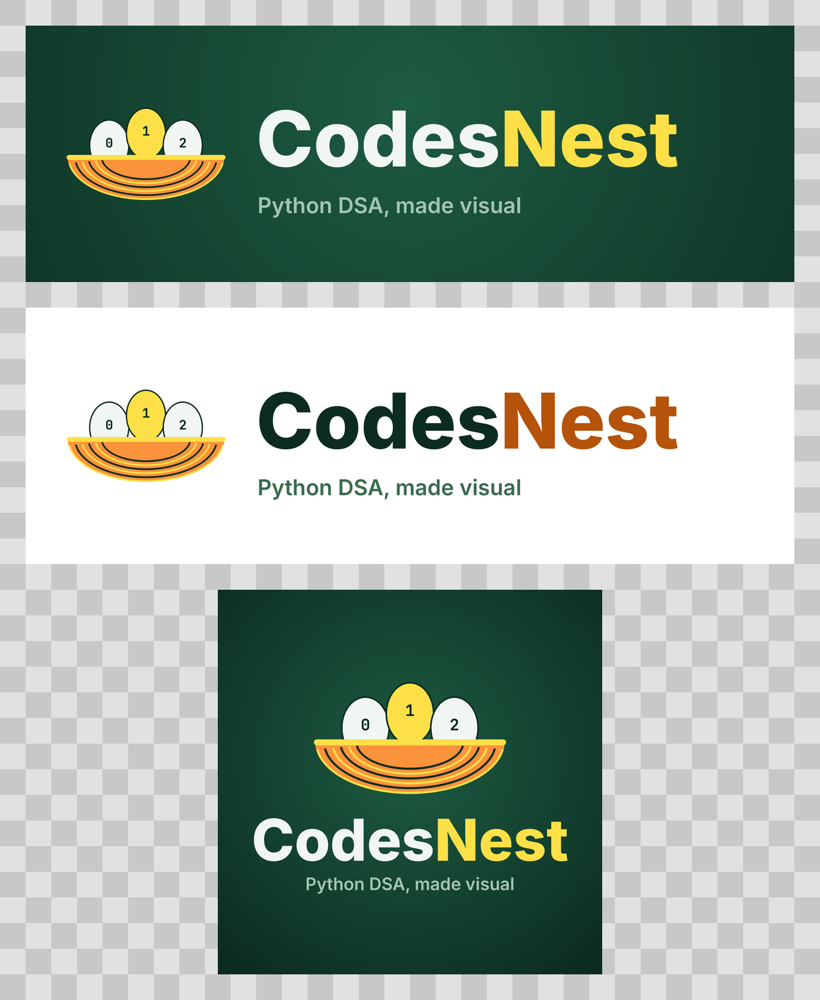
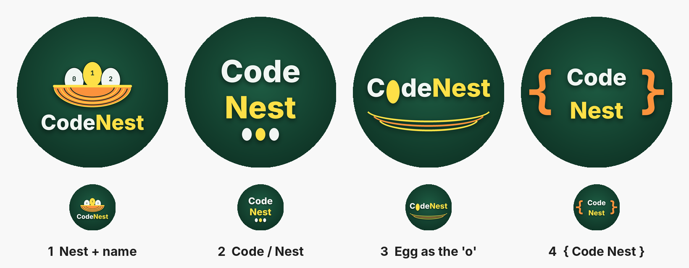
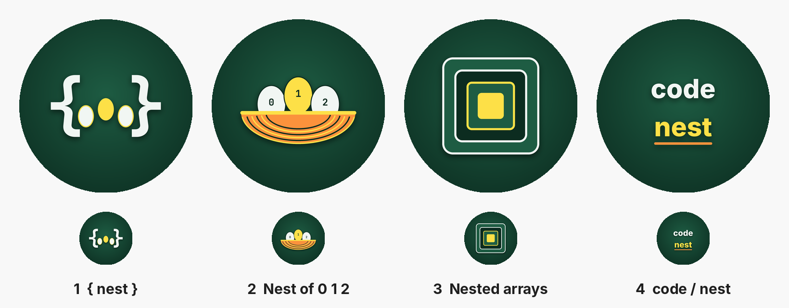

# Profile picture and bio: @codenest

## Logo (no nest or eggs)



| Option | Idea | Verdict |
|---|---|---|
| 1 `[C][N]` list cells | The initials as two list cells with indices 0 and 1, "N" lit as the current item, just like the Reels | **Recommended.** It's the videos' own visual language, so viewers connect the logo to the content. |
| 2 `{CN}` code block | The initials inside orange curly braces | The most instantly "code". Bold at small sizes. |
| 3 N as a graph | The letter N drawn as four graph nodes joined by edges | The most minimal and abstract; reads as "algorithms". |

Files in `logo_v2/`, per option (`cells`, `braces`, `graph`): `*_icon.png` (1080 × 1080,
also usable as the profile picture), `*_horizontal_dark.png` and
`*_horizontal_light.png` (2400 × 800). Regenerate with `python branding/make_logo_v2.py`.

## Logo with the nest (earlier)



The 0 1 2 nest mark beside the wordmark, with the tagline "Python DSA, made visual".
Every file exists in two spellings: `codesnest_*` (Codes**Nest**) and `codenest_*`
(Code**Nest**, matching the @codenest handle).

| File | Use it for |
|---|---|
| `logo/*_horizontal_dark.png` | Banners, YouTube/LinkedIn headers, end cards (2400 × 800) |
| `logo/*_horizontal_light.png` | White backgrounds: documents, slides, websites ("Nest" in amber, since yellow is too faint on white) |
| `logo/*_horizontal_transparent.png` | Placing on dark photos or video |
| `logo/*_stacked_dark.png` | Square posts, a carousel cover (1080 × 1080) |
| `logo/*_stacked_transparent.png` | Stickers, watermarks |
| `logo/icon_transparent.png` | The nest alone, e.g. a small corner watermark |

Regenerate with `python branding/make_logo.py`.

## Profile picture with the name (round 4)



| File | Idea | Verdict |
|---|---|---|
| `v4_avatar_2_stacked_name.png` | **Code** / **Nest** stacked large, with three egg dots underneath | **Most readable.** The name is still clear in the ~110 px feed circle. |
| `v4_avatar_1_nest_and_name.png` | The 0 1 2 nest above "CodeNest" | **Best brand mark.** Logo and name together; the name gets small in the feed, but the nest still reads. |
| `v4_avatar_4_brace_name.png` | `{ Code Nest }` with orange braces | Says "code" the most strongly. |
| `v4_avatar_3_egg_o.png` | "CodeNest" on one line with a yellow egg as the "o" | Clever, but one line is the smallest text of the four. |

Regenerate with `python branding/make_avatars_v4.py`.

## Profile picture without text (round 3)



| File | Idea | Verdict |
|---|---|---|
| `v3_avatar_2_woven_nest.png` | A woven nest holding three eggs numbered **0 1 2**, like list indices, with the middle one lit yellow as the "current item" in the Reels | **Recommended.** It says "nest" at a glance, the indices say "code", and the shape stays clear at feed size. |
| `v3_avatar_1_brace_nest.png` | `{ }` braces as a nest around three eggs | Strong runner-up: very "code", simple and bold. |
| `v3_avatar_4_wordmark.png` | "code / nest" as a two-line wordmark | Spells out the name, but text gets small in the circle at feed size. Better as a Highlight cover or end card. |
| `v3_avatar_3_nested_squares.png` | Nested arrays shrinking to a yellow core | Clean and abstract, but less obviously tied to the name. |

All four are 1080 × 1080, in the videos' dark green and yellow, with the design kept
inside the centre circle that Instagram crops to. They're original artwork and don't
use the Python logo, whose use in logos is restricted by the Python Software
Foundation's trademark policy. Regenerate them with `python branding/make_avatars_v3.py`.

Earlier rounds, from before the page had a name, are still here:
`avatar_options_preview.png` (round 1) and `v2_avatar_options_preview.png` (round 2).

## Name field (searchable, up to 64 characters)

`CodeNest | Python DSA, Animated`

Instagram search matches the **name** field as well as the handle, so the keywords
go there.

## Bio (each one is under 150 characters)

**Option 1: clear and keyword-rich (recommended)**
```
🐍 Python data structures & algorithms, animated
🥚 Lists → arrays → trees → graphs
⏱️ One concept in under a minute
👇 Start with Ep 01
```

**Option 2: plays on the name**
```
Where Python DSA hatches 🥚🐍
Watch data structures move, step by step
🎯 For CS students & coding interviews
New episode weekly 👇
```

**Option 3: coder-style**
```
nest = [lists, arrays, trees, graphs] 🐍
DSA in Python, visualised
💬 Quiz in every caption, answer pinned
👇 Ep 01
```

## Profile setup checklist

- [ ] Switch to a **Creator** account to get insights and the "Education" or "Digital creator" category label
- [ ] **Pin** Reels 01–03 to the top of the grid, so new visitors start at the beginning
- [ ] Make a **Highlight** per season ("Lists", "Collections", "Linked lists", …), with covers in the same dark green
- [ ] Link: optional. A free link-in-bio page or a GitHub repo with the episode code works well for CS students.
- [x] Use the same handle in the videos: all six episodes already show `@codenest`
