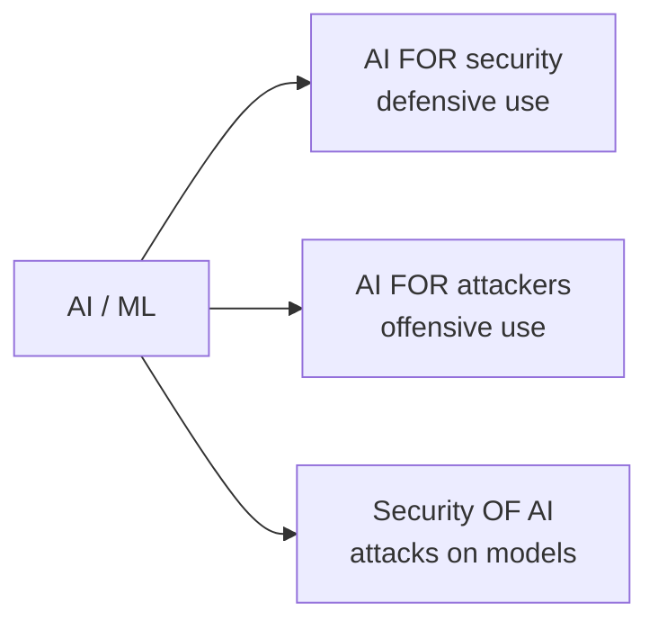
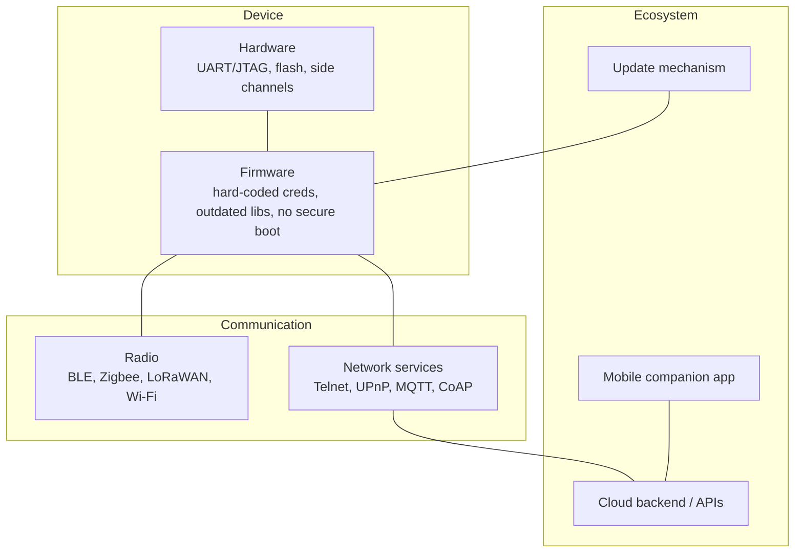

# Module 1 — Advanced Threat Landscape and Emerging Technologies

**Weeks 1–3** · Topics: AI & machine learning in cybersecurity · Quantum computing and post-quantum cryptography · IoT and embedded systems security

---

## Learning outcomes

By the end of this module you should be able to:

1. Describe how today's threat landscape is shaped by attacker economics, supply chains and new technologies.
2. Evaluate where machine learning helps defenders, and explain its limits (base rates, concept drift, explainability).
3. Classify attacks **against** ML systems (evasion, poisoning, extraction, inference, prompt injection) using MITRE ATLAS and the OWASP Top 10 for LLM Applications.
4. Explain why Shor's and Grover's algorithms threaten current cryptography, and compare NIST's post-quantum standards (FIPS 203/204/205).
5. Build a post-quantum migration plan using Mosca's inequality and a cryptographic inventory.
6. Identify the distinctive security constraints of IoT/embedded devices and apply ETSI EN 303 645 / NISTIR 8259 baseline requirements.

---

## 1.1 The modern threat landscape

### 1.1.1 Who attacks, and why

| Actor | Motivation | Typical capability | Example |
|-------|-----------|-------------------|---------|
| Nation-state / APT | Espionage, sabotage, pre-positioning | Very high; zero-days, supply-chain compromise | SolarWinds SUNBURST (2020); Volt Typhoon living-off-the-land in US critical infrastructure (2023–24) |
| Organised cybercrime | Profit | High; Ransomware-as-a-Service (RaaS), initial-access brokers | Colonial Pipeline (DarkSide, 2021); Change Healthcare (ALPHV/BlackCat, 2024) |
| Hacktivists | Ideology, publicity | Low–medium; DDoS, defacement, leaks | Anonymous operations; pro-state DDoS groups |
| Insiders | Grievance, money, error | Legitimate access | Accidental cloud bucket exposure; data theft by departing staff |
| Opportunists / script kiddies | Curiosity, status | Low; public exploits | Mass scanning for unpatched VPN appliances |

### 1.1.2 Structural trends you should be able to discuss

- **Industrialisation of crime.** Ransomware is a service economy: developers, affiliates, access brokers, negotiators and money launderers. *Double extortion* (encrypt + leak) and *triple extortion* (plus DDoS or contacting victims' customers) are standard.
- **Identity is the new perimeter.** Most intrusions begin with stolen credentials, phishing, MFA fatigue or session-token theft, not with exotic exploits.
- **Edge devices are the favourite entry point.** VPN concentrators, firewalls and file-transfer appliances (e.g., MOVEit Transfer, 2023) are internet-facing, hard to monitor and often lack EDR.
- **Software supply chain.** Compromising one vendor or open-source package reaches thousands of victims (SolarWinds 2020, Log4Shell 2021, 3CX 2023, the `xz-utils` backdoor 2024).
- **Living off the land (LotL).** Attackers use built-in tools (PowerShell, WMI, `certutil`, `netsh`) to blend in with administrators.
- **Speed.** Time from initial access to lateral movement ("breakout time") is often measured in minutes to hours.

### 1.1.3 Describing attacks: frameworks

- **Lockheed Martin Cyber Kill Chain** — Reconnaissance → Weaponisation → Delivery → Exploitation → Installation → Command & Control → Actions on Objectives. Useful for intuition; criticised for being perimeter- and malware-centric.
- **MITRE ATT&CK** — a knowledge base of adversary **Tactics** (the *why*: e.g., Initial Access, Persistence, Lateral Movement) and **Techniques/Sub-techniques** (the *how*: e.g., T1566.001 Spearphishing Attachment). The lingua franca for detection engineering and threat intelligence.
- **Diamond Model** — every intrusion event has four vertices: *Adversary, Capability, Infrastructure, Victim*. Good for pivoting during intelligence analysis.

---

## 1.2 AI and machine learning in cybersecurity

AI is a **double-edged** technology: it strengthens defenders, empowers attackers, and is itself a new attack surface.



### 1.2.1 AI as a defensive tool

| Use case | ML approach | Notes / pitfalls |
|----------|-------------|------------------|
| Malware detection | Supervised classification on static features (PE headers, imports, byte n-grams) and dynamic features (API call sequences) | Adversaries adapt; models need continuous retraining |
| Network intrusion detection | Unsupervised anomaly detection (Isolation Forest, autoencoders), supervised flow classification | Benchmark datasets (KDD'99, NSL-KDD) are outdated; real traffic drifts |
| User & Entity Behaviour Analytics (UEBA) | Baselining per user/host; clustering; sequence models | Good for insider threat and compromised accounts |
| Phishing & spam filtering | NLP classifiers, URL/visual similarity | One of the oldest successful ML security applications |
| SOC triage & alert enrichment | LLM copilots summarising alerts, writing queries, drafting reports | Must be grounded in real telemetry; hallucination risk |
| Vulnerability discovery | ML-guided fuzzing; LLM-assisted code review | DARPA AIxCC (2023–25) showed autonomous systems finding and patching bugs |

**The base-rate problem.** Security data is extremely imbalanced. Suppose 1 in 10,000 events is malicious and a detector has 99% true-positive rate and 1% false-positive rate. For 1,000,000 events:

- Malicious = 100 → detected ≈ 99
- Benign = 999,900 → false alarms ≈ 9,999
- **Precision** = 99 / (99 + 9,999) ≈ **0.98%**

Fewer than 1 in 100 alerts is real. This is why accuracy is a misleading metric in security, and why you should report **precision, recall, F1, and false-positive rate per day**.

Other limitations: **concept drift** (benign and malicious behaviour change), **adversarial adaptation**, **label scarcity**, and **explainability** (an analyst must understand why an alert fired).

### 1.2.2 AI as an offensive tool

- **Social engineering at scale:** fluent, personalised phishing in any language; voice cloning and deepfake video (e.g., the 2024 Hong Kong case where an employee was deceived into transferring about US$25 million after a deepfake video call with "executives").
- **Reconnaissance and OSINT automation.**
- **Malware development assistance** and obfuscation; polymorphic code generation.
- **Faster exploitation:** LLM agents assisting with vulnerability research and exploit adaptation.
- **Disinformation** and influence operations.

Assessment: AI mostly **lowers the skill barrier and increases scale and speed** for existing techniques rather than creating fundamentally new attack classes — but that alone shifts the defender's workload significantly.

### 1.2.3 Attacks on AI systems (adversarial ML)

Reference taxonomies: **NIST AI 100-2 (Adversarial Machine Learning: A Taxonomy and Terminology of Attacks and Mitigations)** and **MITRE ATLAS** (ATT&CK-style matrix for AI systems).

| Attack | Lifecycle stage | Description | Example |
|--------|-----------------|-------------|---------|
| **Evasion** (adversarial examples) | Inference | Small, crafted input perturbations cause misclassification | Stickers on stop signs fooling vision models; malware byte padding evading a classifier |
| **Poisoning** | Training | Inject malicious samples to degrade the model or plant a **backdoor** trigger | Poisoned open datasets; backdoored pre-trained models on public hubs |
| **Model extraction / stealing** | Inference | Query an API to reconstruct a functionally equivalent model | Stealing a commercial classifier via its prediction API |
| **Membership inference** | Inference | Determine whether a specific record was in the training set | Privacy breach for medical models |
| **Model inversion / data extraction** | Inference | Reconstruct training data from outputs | Extracting memorised personal data from language models |
| **Prompt injection** | Inference (LLMs) | Instructions hidden in user input or retrieved content override the system's intent | A web page or email that instructs an LLM agent to exfiltrate data |
| **Supply-chain compromise** | Build/deploy | Malicious model files (e.g., unsafe pickle deserialisation), compromised libraries | Malicious models uploaded to model-sharing hubs |

**OWASP Top 10 for LLM Applications (2025):**

1. LLM01 Prompt Injection
2. LLM02 Sensitive Information Disclosure
3. LLM03 Supply Chain
4. LLM04 Data and Model Poisoning
5. LLM05 Improper Output Handling
6. LLM06 Excessive Agency
7. LLM07 System Prompt Leakage
8. LLM08 Vector and Embedding Weaknesses
9. LLM09 Misinformation
10. LLM10 Unbounded Consumption

**Defences (defence in depth for AI):**

- Data provenance, dataset curation, and integrity checks on training data
- Adversarial training; input preprocessing; certified robustness (limited scale)
- Rate limiting and query monitoring against extraction
- Differential privacy during training against membership inference
- For LLM applications: treat model output as **untrusted input**; least privilege for tools/agents; human approval for high-impact actions; separate trusted instructions from untrusted content; output encoding; sandboxing
- Safe model formats (e.g., `safetensors` rather than pickle); scan third-party models
- Red-teaming and evaluation before release

**Governance:** NIST **AI Risk Management Framework (AI RMF 1.0)** — functions *Govern, Map, Measure, Manage*; **ISO/IEC 42001:2023** (AI management system); **EU AI Act** (Regulation (EU) 2024/1689) — risk-tiered obligations (prohibited, high-risk, limited-risk transparency, minimal), phased in from 2025 to 2027.

---

## 1.3 Quantum computing and post-quantum cryptography

### 1.3.1 Why quantum computers threaten cryptography

| Algorithm | Problem | Effect on cryptography | Mitigation |
|-----------|---------|------------------------|------------|
| **Shor (1994)** | Integer factorisation and discrete logarithms in polynomial time | **Breaks** RSA, Diffie-Hellman, DSA, ECDSA, ECDH (all widely used public-key crypto) | Replace with post-quantum algorithms |
| **Grover (1996)** | Unstructured search with quadratic speedup (√N) | **Weakens** symmetric keys and hashes — effective key strength roughly halves | Use AES-256, SHA-384/512 (128-bit-class post-quantum security) |

A **cryptographically relevant quantum computer (CRQC)** does not exist today. Estimates of resources needed to factor RSA-2048 have fallen sharply (from billions of physical qubits in early estimates to under a million noisy qubits in recent research), which is why governments now set concrete migration deadlines.

### 1.3.2 "Harvest now, decrypt later" and Mosca's inequality

Adversaries can record encrypted traffic **today** and decrypt it once a CRQC exists. Therefore data with long confidentiality lifetimes is already at risk.

**Mosca's inequality:** if **X + Y > Z**, you are already late.

- **X** = how long your data must stay secret (shelf-life)
- **Y** = how long migration to quantum-safe crypto will take
- **Z** = time until a CRQC exists

*Worked example:* A health insurer holds records that must stay confidential for 25 years (X = 25). Migrating its systems is estimated at 7 years (Y = 7). Even an optimistic Z of 15 years gives 25 + 7 = 32 > 15 → migration of key exchange should have started already.

Note: *signatures* are less exposed to harvest-now attacks (a forged signature must be made before it is verified), but long-lived roots of trust — firmware signing keys, certificate authorities, code-signing — need early migration because they are hard to replace in the field.

### 1.3.3 NIST post-quantum standards

NIST ran an open competition from 2016. First standards were published in **August 2024**:

| Standard | Algorithm (original name) | Type | Hard problem | Notes |
|----------|---------------------------|------|--------------|-------|
| **FIPS 203** | **ML-KEM** (CRYSTALS-Kyber) | Key encapsulation (KEM) | Module lattices (Module-LWE) | Primary replacement for RSA/ECDH key exchange; parameter sets ML-KEM-512/768/1024 |
| **FIPS 204** | **ML-DSA** (CRYSTALS-Dilithium) | Digital signature | Module lattices | Primary general-purpose signature |
| **FIPS 205** | **SLH-DSA** (SPHINCS+) | Digital signature | Hash functions only (stateless hash-based) | Conservative backup; larger, slower signatures |
| FIPS 206 (in development) | **FN-DSA** (FALCON) | Digital signature | NTRU lattices | Compact signatures; harder to implement safely (floating point) |
| Selected 2025 | **HQC** | KEM | Error-correcting codes | Backup KEM based on a different mathematical family |

Also standardised earlier: **stateful hash-based signatures** LMS and XMSS (NIST SP 800-208) — suitable for firmware signing where state can be managed carefully.

**Trade-offs vs. classical crypto:** PQC keys, ciphertexts and signatures are much larger (e.g., ML-KEM-768 public key ≈ 1,184 bytes vs. 32 bytes for X25519; ML-DSA-65 signature ≈ 3,309 bytes vs. 64 bytes for Ed25519). This affects TLS handshakes, certificates, constrained IoT devices and protocols with packet-size limits.

### 1.3.4 Migration strategy

1. **Inventory** — build a *cryptographic bill of materials (CBOM)*: where is public-key crypto used (TLS, VPN, SSH, code signing, PKI, HSMs, databases, IoT firmware)? Which libraries and protocols?
2. **Prioritise** — by data shelf-life (Mosca), exposure, and replacement difficulty.
3. **Crypto-agility** — design systems so algorithms can be swapped through configuration, not rewrites.
4. **Hybrid deployment** — combine classical and PQC (e.g., **X25519MLKEM768** in TLS 1.3) so security holds if *either* algorithm survives. Major browsers and CDNs already deploy hybrid ML-KEM key exchange by default.
5. **Vendor engagement** — require PQC roadmaps in procurement.
6. **Test** — performance, interoperability, middlebox tolerance of larger handshakes.

**Policy timelines** (know these exist; check current versions): NIST IR 8547 (draft) proposes deprecating quantum-vulnerable algorithms at the 112-bit security level after 2030 and disallowing them after 2035; the US NSA **CNSA 2.0** suite sets transition dates for national security systems through 2030–2033; the UK NCSC targets completing migration by 2035.

> **QKD vs. PQC.** *Quantum key distribution* uses physics (photons) to distribute keys. It needs special hardware and dedicated links, does not provide authentication on its own, and is not recommended by NCSC, NSA or ANSSI as a general solution. PQC is software-deployable on existing networks and is the mainstream answer.

---

## 1.4 IoT and embedded systems security

### 1.4.1 Why IoT is different

| Constraint | Security consequence |
|------------|---------------------|
| Limited CPU, memory, power | Heavy crypto, agents or EDR often impossible |
| Long lifespans (10–20+ years in industry, medical, automotive) | Devices outlive vendor support; legacy protocols persist |
| Physical accessibility | Hardware attacks: debug ports (UART, JTAG/SWD), flash dumping, side channels, fault injection |
| Heterogeneous, proprietary firmware | Hard to inventory and patch; opaque third-party components |
| Cost pressure | Security deprioritised; default credentials; no secure boot |
| Cyber-physical impact | Compromise can cause physical harm (ICS/OT, medical devices, vehicles) |

### 1.4.2 IoT attack surface



**OWASP IoT Top 10 (2018):** weak/guessable/hard-coded passwords; insecure network services; insecure ecosystem interfaces; lack of secure update mechanism; use of insecure or outdated components; insufficient privacy protection; insecure data transfer and storage; lack of device management; insecure default settings; lack of physical hardening.

### 1.4.3 Case study: Mirai (2016)

- Malware scanned the internet for devices (IP cameras, DVRs, routers) with **Telnet open** and tried a list of ~60 **default username/password pairs**.
- Built a botnet of hundreds of thousands of devices.
- Launched record DDoS attacks, including against DNS provider **Dyn** (October 2016), disrupting major websites across the US and Europe.
- Source code was published; variants continue today.
- **Lessons:** default credentials and exposed management services are catastrophic at scale; the device owner suffers little, so market incentives fail → this motivated *regulation*.

Other cases to read: **Stuxnet** (2010, PLC sabotage), **Jeep Cherokee remote hack** (2015, recall of 1.4 million vehicles), **Ukraine power grid attacks** (2015, 2016), **Industroyer2** (2022), **Triton/Trisis** targeting safety instrumented systems (2017).

### 1.4.4 Baseline standards and regulation

- **ETSI EN 303 645** — consumer IoT baseline, 13 provisions; the top three: *no universal default passwords*, *implement a means to manage vulnerability reports*, *keep software updated*.
- **NISTIR 8259 / 8259A** — manufacturer activities and core device cybersecurity capabilities (device identification, configuration, data protection, logical access, software update, cybersecurity state awareness).
- **IEC 62443** — industrial automation and control systems (zones and conduits, security levels SL1–SL4).
- **UK PSTI Act** — product security regime in force since April 2024 (bans default passwords, requires a vulnerability disclosure policy and stated support period).
- **EU Cyber Resilience Act** (Regulation (EU) 2024/2847) — security-by-design obligations for "products with digital elements"; vulnerability-reporting obligations from September 2026 and full obligations from December 2027.
- **US Cyber Trust Mark** — voluntary FCC labelling programme based on NIST criteria.

### 1.4.5 Defensive controls for embedded systems

- **Hardware root of trust** and **secure boot** chain (each stage verifies the signature of the next)
- **Unique per-device credentials** provisioned at manufacture; secure element / TPM for key storage
- **Signed, authenticated OTA updates** with rollback protection; A/B partitions
- **Disable or lock debug interfaces** in production
- **Minimal attack surface** — no Telnet; only required services
- **Network segmentation** — IoT on separate VLANs/SSIDs; deny-by-default egress
- **Lightweight cryptography** — NIST selected **Ascon** (SP 800-232) for constrained devices
- **SBOM** for firmware to track vulnerable components
- **Asset discovery and passive monitoring** for devices that cannot run agents (common in OT)

---

## 1.5 Lab exercises

### Lab 1A — Map an incident to ATT&CK (Week 1)
Pick one public incident report (e.g., a CISA advisory). Produce an ATT&CK Navigator layer marking each technique observed, and for three techniques list a data source and detection idea.

### Lab 1B — ML anomaly detection and evasion (Week 2)
1. Download a modern flow dataset (e.g., CIC-IDS2017 or UNSW-NB15).
2. Train an `IsolationForest` and a `RandomForestClassifier` in scikit-learn.
3. Report precision, recall, F1 and false positives per 10,000 flows. Compare with accuracy and explain the difference.
4. Pick one attack class and modify features within realistic bounds (e.g., packet timing, sizes) to evade the classifier. How much change was needed?

```python
from sklearn.ensemble import RandomForestClassifier
from sklearn.model_selection import train_test_split
from sklearn.metrics import classification_report

X_train, X_test, y_train, y_test = train_test_split(X, y, stratify=y, test_size=0.3, random_state=42)
clf = RandomForestClassifier(n_estimators=200, class_weight="balanced", n_jobs=-1).fit(X_train, y_train)
print(classification_report(y_test, clf.predict(X_test), digits=4))
```

### Lab 1C — Post-quantum TLS (Week 3)
Using OpenSSL 3.5+ (native ML-KEM/ML-DSA support) or the Open Quantum Safe `oqs-provider`:
1. Start a local TLS server and connect with the group `X25519MLKEM768`. Capture the handshake in Wireshark.
2. Compare the size of the ClientHello/ServerHello with a classical `X25519` handshake.
3. Generate an ML-DSA-65 key and certificate; compare sizes with an ECDSA P-256 certificate.

### Lab 1D — Firmware analysis (Week 3)
Download a publicly available router firmware image (or the OWASP IoTGoat image). Use `binwalk -e` to extract the filesystem, then search for hard-coded credentials, private keys, Telnet/dropbear configs and outdated BusyBox versions. Write a one-page finding report mapped to ETSI EN 303 645 provisions.

---

## 1.6 Discussion questions

1. "AI favours the attacker more than the defender." Argue both sides using concrete examples.
2. An LLM-based email assistant can read the inbox and send emails. Describe an indirect prompt-injection attack and three architectural controls that limit its impact.
3. Your CIO says PQC can wait until a quantum computer is announced. Respond using Mosca's inequality and harvest-now-decrypt-later.
4. Why have market forces failed to secure consumer IoT, and does regulation like the EU CRA solve the problem?

---

## 1.7 Self-check quiz

1. Which algorithm breaks RSA and elliptic-curve cryptography?
2. Why is AES-256 still considered quantum-safe?
3. Name the NIST standard and algorithm intended as the primary replacement for ECDH key exchange.
4. In Mosca's inequality, what does Y represent?
5. A detector has 99% recall and 1% false-positive rate; the attack base rate is 0.01%. Is precision closer to 99%, 50% or 1%?
6. What is the difference between a poisoning attack and an evasion attack?
7. Which OWASP LLM risk covers an agent that has more permissions than it needs?
8. What two weaknesses did Mirai exploit?
9. List the top three provisions of ETSI EN 303 645.
10. What is the purpose of a hybrid key exchange such as X25519MLKEM768?

<details>
<summary><strong>Answers</strong></summary>

1. Shor's algorithm.
2. Grover's algorithm only provides a quadratic speedup, reducing AES-256 to roughly 128-bit effective security, which remains infeasible to brute-force.
3. FIPS 203, ML-KEM (formerly CRYSTALS-Kyber).
4. The time needed to migrate systems to quantum-safe cryptography.
5. About 1% (see the base-rate worked example in §1.2.1).
6. Poisoning manipulates training data to corrupt the model or plant a backdoor; evasion manipulates inputs at inference time to cause misclassification of a trained model.
7. LLM06 Excessive Agency.
8. Exposed Telnet services and default/hard-coded credentials.
9. No universal default passwords; implement a means to manage reports of vulnerabilities; keep software updated.
10. To stay secure as long as either the classical or the post-quantum component remains unbroken — protecting against both future quantum attacks and undiscovered weaknesses in the newer PQC algorithm.

</details>

---

## Further reading

- MITRE ATT&CK — https://attack.mitre.org · MITRE ATLAS — https://atlas.mitre.org
- NIST AI 100-2, *Adversarial Machine Learning: A Taxonomy and Terminology of Attacks and Mitigations*
- NIST AI 100-1, *AI Risk Management Framework 1.0* (2023)
- OWASP Top 10 for LLM Applications 2025 — https://genai.owasp.org
- Sommer, R. & Paxson, V. (2010). "Outside the Closed World: On Using Machine Learning for Network Intrusion Detection." *IEEE S&P.*
- Goodfellow, I., Shlens, J. & Szegedy, C. (2015). "Explaining and Harnessing Adversarial Examples." *ICLR.*
- NIST FIPS 203, 204, 205 (August 2024); NIST IR 8547 (draft), *Transition to Post-Quantum Cryptography Standards*
- Mosca, M. (2018). "Cybersecurity in an Era with Quantum Computers: Will We Be Ready?" *IEEE Security & Privacy.*
- ETSI EN 303 645; NISTIR 8259A; IEC 62443 series
- Antonakakis, M. et al. (2017). "Understanding the Mirai Botnet." *USENIX Security.*
