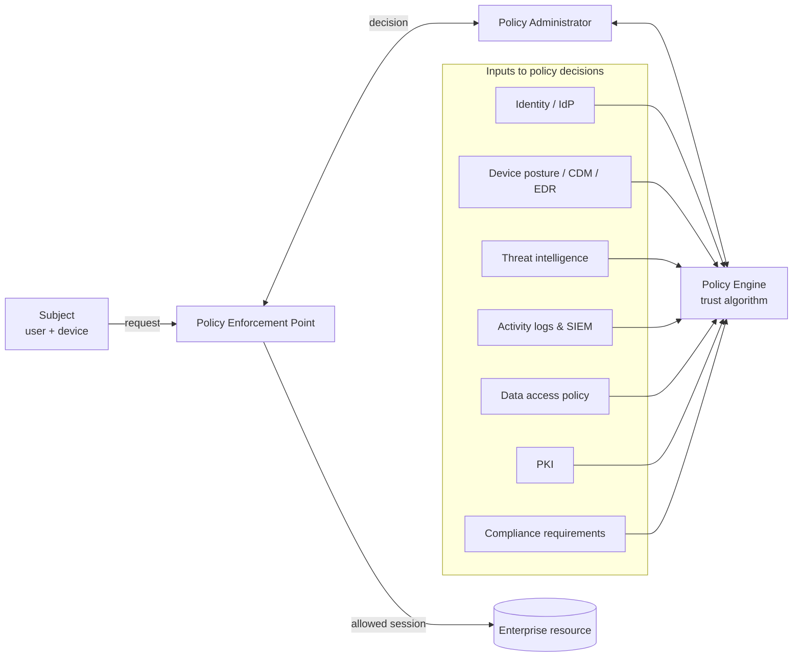

# Module 2 — Zero Trust Architecture and Cloud Security

**Weeks 4–6** · Topics: Principles and implementation of Zero Trust · Cloud security best practices for multi-cloud and hybrid environments · Secure cloud configuration and access control

---

## Learning outcomes

By the end of this module you should be able to:

1. Explain why perimeter-based security fails and state the tenets of Zero Trust from NIST SP 800-207.
2. Describe the logical components of a Zero Trust Architecture (PE, PA, PEP) and the main deployment approaches.
3. Assess an organisation's Zero Trust maturity with the CISA Zero Trust Maturity Model v2.0 and produce a phased roadmap.
4. Apply the shared responsibility model across IaaS, PaaS and SaaS.
5. Design security controls for multi-cloud and hybrid environments (identity federation, centralised logging, policy-as-code, CSPM/CNAPP).
6. Write and review least-privilege IAM policies and identify common cloud misconfigurations.

---

## 2.1 Why Zero Trust?

The traditional **"castle-and-moat"** model trusts anything inside the network perimeter. It breaks down because:

- Users, devices and workloads are everywhere — remote work, SaaS, multiple clouds, mobile, partners.
- Once an attacker gets inside (phishing, a VPN exploit), flat networks allow free **lateral movement**.
- Implicit trust in network location is exactly what ransomware operators exploit.

**Zero Trust (ZT)** is a security *strategy* (not a product) built on: **"never trust, always verify"** and **"assume breach."** The term was popularised by John Kindervag (Forrester, 2010); Google's **BeyondCorp** (2011 onwards) was an influential large-scale implementation that moved access control from the network perimeter to individual users and devices.

### 2.1.1 NIST SP 800-207 — the seven tenets

1. All data sources and computing services are considered **resources**.
2. All communication is **secured regardless of network location** (internal traffic gets no implicit trust).
3. Access to individual enterprise resources is granted on a **per-session** basis.
4. Access is determined by **dynamic policy** — including client identity, application/service, requesting asset state, and behavioural and environmental attributes.
5. The enterprise **monitors and measures the integrity and security posture** of all owned and associated assets.
6. All resource authentication and authorisation are **dynamic and strictly enforced** before access is allowed.
7. The enterprise **collects as much information as possible** about assets, network infrastructure and communications, and uses it to improve its security posture.

### 2.1.2 Logical architecture



- **Policy Engine (PE):** makes the grant/deny decision using a *trust algorithm*.
- **Policy Administrator (PA):** executes the decision — establishes or tears down the session, issues session tokens/credentials.
- **Policy Enforcement Point (PEP):** sits in the data path; enables, monitors and terminates connections (e.g., identity-aware proxy, ZTNA gateway, service-mesh sidecar).
- PE + PA together form the **Policy Decision Point (PDP)**.

### 2.1.3 Deployment approaches (SP 800-207)

| Approach | Core idea | Typical technology |
|----------|-----------|--------------------|
| **Enhanced identity governance** | Identity and attributes drive policy | IdP, conditional access, PAM |
| **Micro-segmentation** | Place resources in small segments protected by gateways/host firewalls | Host-based firewalls, NGFW, SDN, cloud security groups |
| **Software-defined perimeter (SDP) / network infrastructure** | Overlay network; resources invisible until authorised | ZTNA, SDP controllers, mTLS |

In practice, organisations combine all three.

### 2.1.4 CISA Zero Trust Maturity Model (v2.0, 2023)

**Five pillars:** Identity · Devices · Networks · Applications & Workloads · Data
**Three cross-cutting capabilities:** Visibility & Analytics · Automation & Orchestration · Governance
**Four maturity stages:** Traditional → Initial → Advanced → Optimal

| Pillar | Traditional | Advanced / Optimal (examples) |
|--------|-------------|-------------------------------|
| Identity | Passwords, some MFA; static access | Phishing-resistant MFA (FIDO2/passkeys, PIV); continuous validation; risk-based access |
| Devices | Manual inventory; limited compliance checks | Real-time posture (EDR, patch level) feeding every access decision |
| Networks | Large perimeter zones; static rules | Micro-segmentation; encrypted internal traffic; dynamic just-in-time access |
| Apps & Workloads | Apps reachable via VPN | Apps reachable only through authenticated proxies; continuous authorisation; secure SDLC integrated |
| Data | Unclassified data; perimeter protection | Automated classification and tagging; DLP; encryption with granular access control |

The US DoD Zero Trust Reference Architecture uses **seven pillars** (User, Device, Application & Workload, Data, Network & Environment, Automation & Orchestration, Visibility & Analytics) — similar ideas, different grouping.

### 2.1.5 Implementing Zero Trust — a phased roadmap

1. **Define the protect surface** — critical data, applications, assets and services (DAAS). Start small, not with "the whole network."
2. **Map transaction flows** — who/what needs to talk to the protect surface and how.
3. **Strengthen identity** — single IdP, SSO, phishing-resistant MFA, remove standing admin rights (PAM, just-in-time access).
4. **Establish device trust** — inventory, management (MDM/UEM), EDR, compliance signals into conditional access.
5. **Replace broad VPN access with ZTNA** — per-application access via identity-aware proxies.
6. **Micro-segment** — east–west controls around the protect surface; deny by default.
7. **Protect data** — classify, encrypt, DLP, monitor access.
8. **Monitor and automate** — central logging, UEBA, SOAR playbooks that revoke sessions automatically.
9. **Iterate** — expand to the next protect surface.

**Common pitfalls:** treating ZT as a product purchase; ignoring legacy systems that cannot do modern authentication (wrap them with a proxy/PEP); poor user experience driving workarounds; no executive sponsorship; MFA that is phishable (SMS, push without number matching).

---

## 2.2 Cloud security fundamentals

### 2.2.1 Service models and the shared responsibility model

| Responsibility | On-premises | IaaS | PaaS | SaaS |
|----------------|:-----------:|:----:|:----:|:----:|
| Data, classification & accountability | Customer | Customer | Customer | Customer |
| Identity & access management | Customer | Customer | Customer | Customer (mostly) |
| Application | Customer | Customer | Customer | Provider |
| Network controls (security groups, etc.) | Customer | Customer | Shared | Provider |
| Operating system | Customer | Customer | Provider | Provider |
| Virtualisation / host | Customer | Provider | Provider | Provider |
| Physical data centre | Customer | Provider | Provider | Provider |

> **Key point:** the customer is **always** responsible for data, identities and how services are configured. Analyst firms have long predicted that the overwhelming majority of cloud security failures are the customer's fault — misconfiguration and identity, not provider breaches.

### 2.2.2 Top cloud threats

Based on the CSA *Top Threats to Cloud Computing* reports:

- Misconfiguration and inadequate change control
- Identity and access management weaknesses (over-privileged roles, long-lived keys)
- Insecure interfaces and APIs
- Inadequate cloud security strategy and architecture
- Insecure third-party resources and software supply chain
- Insecure software development
- Accidental cloud data disclosure (public buckets, shared snapshots)
- System vulnerabilities

### 2.2.3 Case studies

**Capital One (2019).** An attacker exploited a **server-side request forgery (SSRF)** flaw in a misconfigured web application firewall running on EC2. The SSRF reached the **instance metadata service (IMDSv1)** and retrieved temporary credentials of an IAM role that had **excessive S3 permissions**. ~100 million customer records were exfiltrated. Lessons: least privilege for workload roles; enforce **IMDSv2** (session-token based, mitigates SSRF); detect unusual `ListBuckets`/`GetObject` patterns; regulatory fine of US$80 million.

**Snowflake customer breaches (2024).** Attackers used credentials stolen by infostealer malware to log in to customer tenants of a SaaS data platform where **MFA was not enforced** and there were no network allow-lists. Many large organisations lost data. Lessons: SaaS is still your responsibility for identity; enforce MFA and SSO; network policies; monitor for anomalous queries; credential hygiene.

**Microsoft Storm-0558 (2023).** A China-based actor used an acquired **consumer signing key** to forge authentication tokens for enterprise email. The US Cyber Safety Review Board criticised a "cascade of security failures." Lessons: provider-side risk exists too; protection of signing keys; token validation logic; logging availability for customers.

---

## 2.3 Multi-cloud and hybrid environments

Organisations use multiple clouds for best-of-breed services, resilience, regulation, or because of mergers. Hybrid environments connect on-premises data centres to the cloud. Each provider has **different IAM models, logging formats, defaults and terminology**, which multiplies the chance of error.

### 2.3.1 Best practices

| Area | Practice |
|------|----------|
| **Governance** | A single cloud security policy and control set mapped to all providers (e.g., CSA **Cloud Controls Matrix v4**, CIS Benchmarks per provider); a cloud centre of excellence |
| **Account/landing-zone structure** | Separate accounts/subscriptions/projects per environment and workload; organisation-level guardrails (AWS SCPs, Azure Policy, GCP Organization Policies) |
| **Identity** | One authoritative IdP federated to every cloud (SAML/OIDC); no local IAM users where avoidable; workload identity federation instead of static keys |
| **Network** | Private connectivity (Direct Connect / ExpressRoute / Interconnect); hub-and-spoke with central inspection; no direct internet exposure of management planes |
| **Data protection** | Encryption at rest and in transit by default; customer-managed keys (KMS/HSM) for sensitive data; data residency controls |
| **Visibility** | Centralise logs (CloudTrail, Azure Activity/Entra logs, GCP Cloud Audit Logs, flow logs) into one SIEM in a separate security account with immutable storage |
| **Posture management** | **CSPM** for misconfiguration; **CIEM** for entitlements; **CWPP** for workloads; increasingly unified as **CNAPP** |
| **Infrastructure as Code (IaC)** | Terraform/OpenTofu, Bicep, CloudFormation; scan IaC in CI (Checkov, tfsec/Trivy, KICS); **policy-as-code** (OPA/Rego, Sentinel) |
| **Incident response** | Cloud-specific playbooks; pre-provisioned forensic accounts; practise isolating instances and revoking sessions |
| **Resilience** | Multi-region design; backups in a separate account with immutability; avoid single-provider dependencies for critical identity paths |

### 2.3.2 Terminology across providers

| Concept | AWS | Azure | Google Cloud |
|---------|-----|-------|--------------|
| Organisation guardrails | Organizations + Service Control Policies | Management Groups + Azure Policy | Resource Manager + Organization Policy |
| Identity service | IAM / IAM Identity Center | Microsoft Entra ID + Azure RBAC | Cloud IAM / Cloud Identity |
| Control-plane audit log | CloudTrail | Activity Log / Entra audit logs | Cloud Audit Logs |
| Key management | KMS / CloudHSM | Key Vault / Managed HSM | Cloud KMS / Cloud HSM |
| Native posture/threat detection | Security Hub, GuardDuty | Defender for Cloud | Security Command Center |
| Network firewall rules | Security Groups, NACLs | Network Security Groups | VPC firewall rules |

---

## 2.4 Secure cloud configuration and access control

### 2.4.1 Identity and Access Management principles

- **Least privilege** — grant the minimum actions on the minimum resources. Start with nothing and add; use access analysers to trim unused permissions.
- **No long-lived credentials** — prefer roles, temporary credentials and workload identity federation (e.g., GitHub Actions OIDC → cloud role) over access keys.
- **Phishing-resistant MFA** for all humans, mandatory for privileged roles; protect the root/global admin account (hardware key, no daily use, break-glass procedure).
- **Separation of duties** — the person who deploys should not be able to disable logging.
- **Just-in-time (JIT) privileged access** — elevate for a time-bound window with approval and audit.
- **Access models** — RBAC (roles), ABAC (attributes/tags), and ReBAC (relationships). Cloud providers increasingly support ABAC via tags.
- **Regular access reviews** and automated removal of unused identities.

### 2.4.2 Reading an IAM policy (AWS example)

**Bad policy — over-privileged:**

```json
{
  "Version": "2012-10-17",
  "Statement": [{ "Effect": "Allow", "Action": "s3:*", "Resource": "*" }]
}
```

**Better — least privilege, scoped, with conditions:**

```json
{
  "Version": "2012-10-17",
  "Statement": [
    {
      "Sid": "ReadReportsBucketOnly",
      "Effect": "Allow",
      "Action": ["s3:GetObject"],
      "Resource": "arn:aws:s3:::acme-reports-prod/reports/*",
      "Condition": {
        "Bool": { "aws:SecureTransport": "true" },
        "StringEquals": { "aws:PrincipalTag/team": "finance" }
      }
    }
  ]
}
```

Evaluation logic to remember: **explicit Deny > explicit Allow > implicit deny**. Organisation-level SCPs set the *maximum* permissions; they never grant anything themselves.

### 2.4.3 Common misconfigurations and their fixes

| Misconfiguration | Risk | Control |
|------------------|------|---------|
| Public storage buckets / blobs | Data exposure | Block-public-access at org level; CSPM alerts |
| Security group open to `0.0.0.0/0` on SSH/RDP/DB ports | Brute force, exploitation | Bastion / session manager; IP allow-lists; ZTNA |
| Logging disabled or deletable | No detection or forensics | Org-wide trails to a separate locked-down account; object lock |
| Unencrypted volumes/snapshots, public snapshots | Data exposure | Default encryption; deny public sharing via policy |
| Over-privileged workload roles; wildcard policies | Privilege escalation, blast radius | Least privilege; access analyser; permission boundaries |
| Long-lived access keys in code repositories | Credential theft | Secret scanning; OIDC federation; rotate/revoke |
| IMDSv1 enabled | SSRF → credential theft | Require IMDSv2; hop limit 1 |
| Root account without MFA / used daily | Total compromise | Hardware MFA; no access keys; alert on use |
| Exposed Kubernetes dashboards / APIs | Cluster takeover, cryptojacking | Private endpoints; RBAC; authentication |

### 2.4.4 Data protection in the cloud

- **Encryption at rest** with provider-managed keys (default) or **customer-managed keys (CMK)**; for the strictest needs, **bring/hold your own key** (BYOK/HYOK) or external key management.
- **Envelope encryption:** data encrypted with a data key (DEK); DEK encrypted with a key-encryption key (KEK) in KMS.
- **Encryption in transit:** TLS 1.2+ (prefer 1.3); mTLS between services.
- **Confidential computing:** hardware-based trusted execution environments (AMD SEV-SNP, Intel TDX, Arm CCA) protect data **in use**.
- **Tokenisation and masking** for analytics on sensitive data.
- **Key rotation**, access logging on key usage, and separation between key administrators and data users.

---

## 2.5 Lab exercises

### Lab 2A — Zero Trust design (Week 4)
Case: *MedCare*, a 2,000-employee hospital group with an on-premises EHR system, Microsoft 365, a public patient portal on AWS, remote clinicians and many medical IoT devices.
1. Identify three protect surfaces.
2. Draw transaction flows for one of them.
3. Place PE/PA/PEP components on a diagram.
4. Assess current maturity per CISA pillar (assume "Traditional" unless stated) and propose an 18-month roadmap with milestones.

### Lab 2B — Cloud posture assessment (Week 5)
In a sandbox cloud account, deliberately deploy a vulnerable environment (e.g., **CloudGoat** for AWS or similar intentionally vulnerable projects). Run **Prowler** or **ScoutSuite**. Triage the top 10 findings by severity and exploitability, map each to a CIS Benchmark control, and remediate three of them with IaC. **Destroy all resources afterwards.**

### Lab 2C — Least-privilege IAM (Week 6)
1. Given an application that reads from one bucket prefix and writes to one DynamoDB table, write a least-privilege policy.
2. Validate it with the provider's policy simulator / IAM Access Analyzer.
3. Replace a static access key used by a CI pipeline with OIDC federation and a role with a trust policy restricted to one repository and branch.

---

## 2.6 Discussion questions

1. "Zero Trust means we can remove our firewalls." Critically evaluate this statement.
2. How would you apply Zero Trust to operational technology (OT) devices that cannot authenticate?
3. Multi-cloud increases resilience but also increases attack surface. When is it justified from a security perspective?
4. Who was at fault in the Snowflake customer breaches — the SaaS provider or its customers? Use the shared responsibility model.

---

## 2.7 Self-check quiz

1. Name the three logical components of a ZTA in SP 800-207.
2. What are the five pillars of the CISA ZTMM v2.0?
3. In IaaS, who is responsible for patching the guest operating system?
4. What is the precedence order in AWS policy evaluation?
5. How does IMDSv2 mitigate SSRF-based credential theft?
6. What does a CSPM tool do, and how does CIEM differ?
7. Why is OIDC workload identity federation preferred over static keys in CI/CD?
8. Give two examples of phishing-resistant MFA.
9. What is envelope encryption?
10. What is a "protect surface"?

<details>
<summary><strong>Answers</strong></summary>

1. Policy Engine (PE), Policy Administrator (PA), Policy Enforcement Point (PEP).
2. Identity, Devices, Networks, Applications & Workloads, Data.
3. The customer.
4. Explicit Deny overrides everything; then explicit Allow; otherwise implicit deny. SCPs and permission boundaries cap the maximum permissions.
5. It requires a session token obtained via a PUT request with a custom header, which simple SSRF (usually GET-only) cannot perform; a hop limit of 1 also stops containers/forwarded requests from reaching it.
6. CSPM continuously checks cloud resource configurations against policies/benchmarks; CIEM analyses identities and their effective entitlements to find excessive or unused permissions.
7. Credentials are short-lived, scoped to a specific repo/branch via trust conditions, and there is no secret to leak or rotate.
8. FIDO2 security keys / passkeys (WebAuthn); smart cards / PIV/CAC certificates.
9. Data is encrypted with a data encryption key (DEK), and the DEK is itself encrypted with a key-encryption key (KEK) held in a KMS/HSM.
10. The small set of critical data, applications, assets and services (DAAS) around which Zero Trust controls are built first.

</details>

---

## Further reading

- NIST SP 800-207, *Zero Trust Architecture* (2020); NIST SP 1800-35, *Implementing a Zero Trust Architecture*
- CISA, *Zero Trust Maturity Model* v2.0 (2023)
- Ward, R. & Beyer, B. (2014). "BeyondCorp: A New Approach to Enterprise Security." *;login:*
- Cloud Security Alliance — *Cloud Controls Matrix v4*; *Security Guidance v5*; *Top Threats to Cloud Computing*
- NIST SP 800-210, *General Access Control Guidance for Cloud Systems*; SP 800-162 (ABAC)
- CIS Foundations Benchmarks for AWS, Azure and GCP
- US Cyber Safety Review Board, *Review of the Summer 2023 Microsoft Exchange Online Intrusion* (2024)
