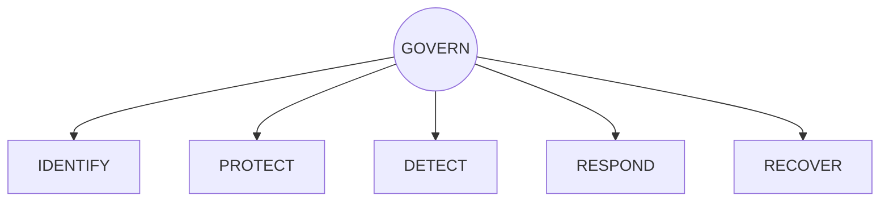
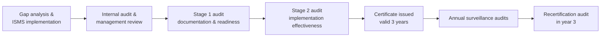

# Module 3 — Compliance and Security Frameworks

**Weeks 7–8** · Topics: GDPR requirements and implementation · NIST Cybersecurity Framework application · ISO/IEC 27001 Information Security Management System

---

## Learning outcomes

By the end of this module you should be able to:

1. Distinguish between **laws/regulations**, **standards**, and **frameworks**, and explain how they interact.
2. Explain GDPR's scope, principles, lawful bases, data-subject rights and controller/processor obligations, and apply them to a realistic system.
3. Conduct a Data Protection Impact Assessment (DPIA) and plan a 72-hour breach notification.
4. Use NIST CSF 2.0 Functions, Categories, Profiles and Tiers to perform a gap analysis.
5. Describe the structure of ISO/IEC 27001:2022 (Clauses 4–10, Annex A), the Statement of Applicability and the certification process.
6. Map controls between frameworks so one control set satisfies several obligations.

---

## 3.1 Laws, standards and frameworks — what's the difference?

| Type | Nature | Examples | Consequence of not following |
|------|--------|----------|------------------------------|
| **Law / regulation** | Mandatory within a jurisdiction | GDPR, NIS2, DORA, HIPAA, India DPDP Act 2023 | Fines, sanctions, liability |
| **Standard** | Formal, consensus-based specification; often certifiable | ISO/IEC 27001, PCI DSS v4.0, IEC 62443 | Loss of certification, contract breach |
| **Framework** | Voluntary structure/guidance for organising a programme | NIST CSF 2.0, CIS Controls v8.1, COBIT | No direct penalty; weaker programme |

> **Compliance ≠ security.** Compliance demonstrates that a baseline is met at a point in time; security is the continuous ability to resist and recover from attacks. Many breached organisations were "compliant." Use frameworks as a means, not the goal.

---

## 3.2 General Data Protection Regulation (GDPR)

Regulation (EU) 2016/679, applicable since **25 May 2018**. The UK retains an almost identical "UK GDPR" alongside the Data Protection Act 2018.

### 3.2.1 Scope and key definitions

- **Material scope:** processing of **personal data** — any information relating to an identified or identifiable natural person (names, IDs, IP addresses, cookie identifiers, location data, etc.).
- **Territorial scope (Art. 3):** applies to organisations **established in the EU**, *and* to non-EU organisations that **offer goods/services to** or **monitor the behaviour of** people in the EU.
- **Controller:** determines the *purposes and means* of processing.
- **Processor:** processes data *on behalf of* the controller (e.g., a cloud or payroll provider). Must have a contract under **Art. 28**.
- **Special categories (Art. 9):** racial/ethnic origin, political opinions, religious beliefs, trade-union membership, genetic data, biometric data for identification, health, sex life/sexual orientation — processing prohibited unless an Art. 9(2) condition applies.
- **Pseudonymised data** is still personal data; truly **anonymised** data is not.

### 3.2.2 The seven principles (Art. 5)

1. **Lawfulness, fairness and transparency**
2. **Purpose limitation** — collected for specified, explicit, legitimate purposes
3. **Data minimisation** — adequate, relevant, limited to what is necessary
4. **Accuracy**
5. **Storage limitation** — kept no longer than necessary
6. **Integrity and confidentiality** — appropriate security (the "security principle")
7. **Accountability** — the controller must be able to **demonstrate** compliance

### 3.2.3 Lawful bases (Art. 6)

| Basis | When to use | Watch out for |
|-------|-------------|---------------|
| Consent | Genuine choice; can be withdrawn | Must be freely given, specific, informed, unambiguous, as easy to withdraw as to give (Art. 7); rarely valid for employees |
| Contract | Necessary to perform a contract with the data subject | Only what is *necessary* for the contract |
| Legal obligation | Required by law (e.g., tax records) | Must identify the law |
| Vital interests | Protect someone's life | Emergencies only |
| Public task | Official functions of public authorities | Mainly public sector |
| Legitimate interests | Balanced against the individual's rights | Requires a documented **legitimate interests assessment** |

### 3.2.4 Data-subject rights (Arts. 12–22)

Right to be informed (13–14) · access (15) · rectification (16) · erasure / "right to be forgotten" (17) · restriction (18) · data portability (20) · object (21) · not to be subject to solely automated decisions with legal or similarly significant effects (22).

Respond **without undue delay and within one month**, extendable by two further months for complex requests. Verify identity before disclosing data — data-subject access requests are a known social-engineering vector.

### 3.2.5 Security-relevant obligations

| Article | Obligation | Implementation in practice |
|---------|-----------|----------------------------|
| **25** | Data protection **by design and by default** | Privacy requirements in the SDLC; minimal data collected by default; pseudonymisation |
| **28** | Processor contracts | DPAs with every vendor; sub-processor approval; audit rights |
| **30** | **Records of processing activities (RoPA)** | Data inventory: purposes, categories, recipients, transfers, retention, security measures |
| **32** | **Security of processing** — "appropriate technical and organisational measures" | Risk-based: pseudonymisation and encryption; confidentiality, integrity, availability and resilience; ability to restore; regular testing |
| **33** | Notify the **supervisory authority within 72 hours** of becoming aware of a personal data breach (unless unlikely to result in risk) | Incident response plan with legal/DPO involvement; breach register for *all* breaches |
| **34** | Notify **data subjects without undue delay** when breach is likely to result in **high risk** | Exemption if data was encrypted and keys were not compromised |
| **35** | **DPIA** for processing likely to result in high risk | Required for e.g. large-scale special-category data, systematic monitoring of public areas, profiling with significant effects |
| **37–39** | **Data Protection Officer** where core activities involve large-scale monitoring or special-category data, or for public authorities | Independent, expert, reports to the highest management level |
| **44–49** | **International transfers** | Adequacy decision (Art. 45), or safeguards such as **Standard Contractual Clauses** / Binding Corporate Rules (Art. 46) plus a transfer impact assessment |

**Transfers to the US — a short history:** Safe Harbor invalidated (*Schrems I*, 2015) → Privacy Shield invalidated (*Schrems II*, C-311/18, 2020) → **EU-US Data Privacy Framework** adequacy decision (July 2023) for self-certified US organisations. The DPF has faced legal challenges; know that this area changes.

### 3.2.6 Fines (Art. 83)

- Up to **€10 million or 2%** of worldwide annual turnover (whichever is higher) — e.g., Arts. 25, 28, 30, 32, 33, 35.
- Up to **€20 million or 4%** — e.g., principles (Art. 5), lawful basis (Art. 6), consent, data-subject rights, international transfers.

Notable enforcement: **Meta €1.2 billion** (Irish DPC, 2023, unlawful transfers to the US); **Amazon €746 million** (Luxembourg, 2021, advertising); **British Airways £20 million** (UK ICO, 2020, security failures leading to card-skimming of ~400,000 customers); **TikTok €530 million** (Irish DPC, 2025, transfers to China).

### 3.2.7 Worked example: 72-hour breach timeline

*Scenario:* At 09:00 Monday, the SOC confirms that an attacker exfiltrated a database containing 50,000 customers' names, emails and hashed passwords (bcrypt) from an e-commerce site.

| Time | Action |
|------|--------|
| Mon 09:00 | **Awareness** — the 72-hour clock starts when the controller is reasonably certain a breach occurred |
| Mon 09:30 | Activate incident response; contain (rotate credentials, block exfiltration path); preserve evidence |
| Mon 12:00 | DPO and legal assess risk: contact data + hashed passwords → risk of phishing and credential stuffing → **notifiable** to supervisory authority |
| Tue | Assess whether **high risk** to individuals (Art. 34). Strong hashing reduces but does not eliminate risk; reused passwords → recommend notifying users and forcing password resets |
| Wed (before 09:00 Thu) | Submit Art. 33 notification: nature of breach, categories and approximate numbers, DPO contact, likely consequences, measures taken. Information may be provided **in phases** if not all known yet |
| Following weeks | Notify data subjects; record in breach register; root-cause analysis; lessons learned |

Remember other parallel clocks: **NIS2** (EU 2022/2555) requires an *early warning* to the CSIRT/authority within **24 hours** and an incident notification within **72 hours** for significant incidents at essential/important entities; **DORA** imposes similar tight timelines on financial entities; payment-card brands and cyber-insurers have their own requirements.

### 3.2.8 DPIA structure (Art. 35(7))

1. Systematic description of the processing and its purposes
2. Assessment of necessity and proportionality
3. Assessment of risks to the rights and freedoms of data subjects (likelihood × severity — **from the individual's perspective**, not the company's)
4. Measures to address the risks (safeguards, security, mechanisms to demonstrate compliance)
5. If high residual risk remains → **prior consultation** with the supervisory authority (Art. 36)

---

## 3.3 NIST Cybersecurity Framework 2.0

Originally published in 2014 for US critical infrastructure; **CSF 2.0** (February 2024) is explicitly intended for **all organisations** of any size or sector, worldwide.

### 3.3.1 Structure

The **CSF Core** is a hierarchy: **Functions → Categories → Subcategories**, with *Informative References* (mappings to SP 800-53, ISO 27001, CIS Controls, etc.) and *Implementation Examples*.

**Six Functions, 22 Categories, 106 Subcategories:**

| Function | Purpose | Categories |
|----------|---------|------------|
| **Govern (GV)** — *new in 2.0* | Establish and monitor risk strategy, expectations and policy | GV.OC Organizational Context · GV.RM Risk Management Strategy · GV.RR Roles, Responsibilities & Authorities · GV.PO Policy · GV.OV Oversight · GV.SC Cybersecurity Supply Chain Risk Management |
| **Identify (ID)** | Understand current cybersecurity risks | ID.AM Asset Management · ID.RA Risk Assessment · ID.IM Improvement |
| **Protect (PR)** | Safeguards to manage risks | PR.AA Identity Management, Authentication & Access Control · PR.AT Awareness & Training · PR.DS Data Security · PR.PS Platform Security · PR.IR Technology Infrastructure Resilience |
| **Detect (DE)** | Find and analyse possible attacks | DE.CM Continuous Monitoring · DE.AE Adverse Event Analysis |
| **Respond (RS)** | Act on a detected incident | RS.MA Incident Management · RS.AN Incident Analysis · RS.CO Incident Response Reporting & Communication · RS.MI Incident Mitigation |
| **Recover (RC)** | Restore assets and operations | RC.RP Incident Recovery Plan Execution · RC.CO Incident Recovery Communication |

Example subcategory: **PR.AA-03** — "Users, services, and hardware are authenticated."

### 3.3.2 Profiles and Tiers

- **Organizational Profiles** describe outcomes: a **Current Profile** (what is achieved today) and a **Target Profile** (what is desired). The gap between them drives an action plan. **Community Profiles** are shared baselines for a sector or use case.
- **Tiers** characterise the *rigour of governance and risk-management practices* (not maturity of individual controls):

| Tier | Name | Characteristics |
|------|------|-----------------|
| 1 | Partial | Ad hoc, reactive; limited awareness of risk |
| 2 | Risk Informed | Management-approved practices but not organisation-wide policy |
| 3 | Repeatable | Formally approved, organisation-wide, regularly updated |
| 4 | Adaptive | Continuously improved from lessons learned and predictive indicators; part of culture |

Tier 4 is not automatically the right target — choose the tier that fits the organisation's risk and resources.

### 3.3.3 Applying the CSF — seven steps

1. **Scope** — business unit, systems, mission priorities.
2. **Gather information** — assets, threats, regulatory requirements, risk appetite.
3. **Create a Current Profile** — rate each relevant subcategory (e.g., 0 = not implemented … 4 = fully implemented and measured).
4. **Conduct a risk assessment** — prioritise based on likelihood and impact.
5. **Create a Target Profile** — informed by risk, community profiles and regulation.
6. **Analyse gaps and create an action plan** — prioritised, costed, owned, time-bound (a *POA&M*).
7. **Implement and monitor** — feed results back; repeat.

### 3.3.4 Worked gap-analysis extract

| Subcategory | Current (0–4) | Target | Gap | Action | Owner | Priority |
|-------------|:-------------:|:------:|:---:|--------|-------|:--------:|
| GV.SC-04 Suppliers are known and prioritised by criticality | 1 | 3 | 2 | Build supplier inventory; tier by criticality; add security clauses | Procurement + CISO | High |
| PR.AA-03 Authentication | 2 | 4 | 2 | Phishing-resistant MFA for admins and remote access | IAM lead | High |
| DE.CM-01 Networks monitored | 2 | 3 | 1 | Deploy NDR on data-centre core; forward to SIEM | SOC manager | Medium |
| RC.RP-03 Integrity of backups verified before restore | 0 | 3 | 3 | Immutable backups; quarterly restore tests | Infrastructure | High |

---

## 3.4 ISO/IEC 27001:2022 — Information Security Management System

ISO/IEC 27001 specifies requirements for **establishing, implementing, maintaining and continually improving an ISMS**. It is **certifiable** by accredited certification bodies. The 2022 revision (with Amendment 1:2024 adding climate-change considerations to Clause 4) replaced the 2013 edition; the transition deadline for certified organisations was **31 October 2025**.

### 3.4.1 Management-system clauses (Harmonised Structure)

Clauses 0–3 are introductory. Clauses **4–10 are mandatory requirements** and follow the **Plan-Do-Check-Act** cycle:

| PDCA | Clause | Key requirements |
|------|--------|------------------|
| Plan | **4 Context of the organisation** | Internal/external issues; interested parties and their requirements; **ISMS scope** |
| Plan | **5 Leadership** | Top-management commitment; **information security policy**; roles and responsibilities |
| Plan | **6 Planning** | **Risk assessment** and **risk treatment** processes; **Statement of Applicability**; security objectives; planning of changes |
| Do | **7 Support** | Resources, competence, awareness, communication, documented information |
| Do | **8 Operation** | Operational planning; perform risk assessments and treatment at planned intervals |
| Check | **9 Performance evaluation** | Monitoring and measurement; **internal audit**; **management review** |
| Act | **10 Improvement** | Continual improvement; **nonconformity and corrective action** |

### 3.4.2 Annex A controls

Annex A lists **93 controls** in **4 themes** (down from 114 controls in 14 domains in 2013). Detailed guidance is in **ISO/IEC 27002:2022**.

| Theme | Controls | Examples |
|-------|:--------:|----------|
| 5 Organisational | 37 | 5.1 Policies · 5.7 Threat intelligence · 5.15 Access control · 5.19–5.23 Supplier and cloud security · 5.24–5.28 Incident management · 5.30 ICT readiness for business continuity · 5.34 Privacy and protection of PII |
| 6 People | 8 | 6.1 Screening · 6.3 Awareness, education and training · 6.7 Remote working · 6.8 Event reporting |
| 7 Physical | 14 | 7.1 Physical perimeters · 7.4 Physical security monitoring · 7.10 Storage media · 7.14 Secure disposal |
| 8 Technological | 34 | 8.2 Privileged access · 8.5 Secure authentication · 8.7 Malware protection · 8.8 Technical vulnerability management · 8.13 Backup · 8.15 Logging · 8.16 Monitoring · 8.24 Cryptography · 8.25–8.29 Secure development and testing |

**11 new controls in 2022:** 5.7 Threat intelligence · 5.23 Information security for use of cloud services · 5.30 ICT readiness for business continuity · 7.4 Physical security monitoring · 8.9 Configuration management · 8.10 Information deletion · 8.11 Data masking · 8.12 Data leakage prevention · 8.16 Monitoring activities · 8.23 Web filtering · 8.28 Secure coding.

ISO/IEC 27002:2022 tags each control with **attributes** — control type (preventive/detective/corrective), security properties (C/I/A), cybersecurity concepts (Identify/Protect/Detect/Respond/Recover — aligning with NIST CSF), operational capabilities and security domains — making cross-framework mapping easier.

### 3.4.3 Risk treatment and the Statement of Applicability (SoA)

1. Identify risks to confidentiality, integrity and availability within scope (guidance: **ISO/IEC 27005:2022**).
2. Analyse and evaluate against risk acceptance criteria.
3. Choose treatment options (modify, retain, avoid, share).
4. Determine **necessary controls** (from any source) and **compare them with Annex A** to ensure nothing important is omitted.
5. Produce the **SoA**: every Annex A control, whether it is included, the justification for inclusion or exclusion, and its implementation status.
6. Get risk owners' approval of the treatment plan and acceptance of residual risk.

| Control | Applicable? | Justification | Status |
|---------|:-----------:|---------------|--------|
| 5.23 Cloud services | Yes | Core systems on AWS and Microsoft 365 (risk R-12, R-15) | Implemented |
| 7.4 Physical security monitoring | No | No organisation-controlled premises in scope; data centres covered by provider SOC 2 / ISO 27001 reports | N/A |
| 8.28 Secure coding | Yes | In-house development of customer portal (risk R-07) | Partially implemented |

### 3.4.4 Mandatory documented information (selection)

ISMS scope (4.3) · information security policy (5.2) · risk assessment process (6.1.2) and results (8.2) · risk treatment process (6.1.3) and results (8.3) · Statement of Applicability (6.1.3 d) · information security objectives (6.2) · evidence of competence (7.2) · operational planning and control documents (8.1) · monitoring and measurement results (9.1) · internal audit programme and results (9.2) · management review results (9.3) · nonconformities and corrective actions (10.2).

### 3.4.5 Certification process

Findings are graded as **major nonconformity** (requirement not met or systemic failure — blocks certification until corrected), **minor nonconformity** (isolated lapse), and **opportunities for improvement**.

### 3.4.6 The ISO/IEC 27000 family

27000 (vocabulary) · 27001 (requirements) · 27002 (controls guidance) · 27003 (implementation guidance) · 27005 (risk management) · 27017 (cloud controls) · 27018 (PII in public clouds) · **27701** (privacy information management — supports GDPR) · 27035 (incident management) · 27036 (supplier relationships).

---

## 3.5 Mapping across frameworks

A single, well-designed control satisfies multiple obligations. Build a **unified control framework** rather than separate programmes.

| Control area | GDPR | NIST CSF 2.0 | ISO/IEC 27001:2022 Annex A |
|--------------|------|--------------|-----------------------------|
| Governance & policy | Art. 5(2) accountability, Art. 24 | GV.PO, GV.RR | 5.1, 5.2, 5.4 |
| Asset & data inventory | Art. 30 RoPA | ID.AM | 5.9, 5.12 |
| Risk assessment | Art. 32, Art. 35 DPIA | ID.RA, GV.RM | Clause 6.1.2, 8.2 |
| Access control | Art. 32 | PR.AA | 5.15–5.18, 8.2, 8.5 |
| Encryption | Arts. 32, 34(3)(a) | PR.DS | 8.24 |
| Supplier management | Art. 28 | GV.SC | 5.19–5.23 |
| Logging & monitoring | Art. 32(1)(d) | DE.CM, DE.AE | 8.15, 8.16 |
| Incident response & notification | Arts. 33–34 | RS.MA, RS.CO | 5.24–5.28 |
| Backup & continuity | Art. 32(1)(b)(c) | PR.IR, RC.RP | 5.29, 5.30, 8.13 |
| Secure development / privacy by design | Art. 25 | PR.PS | 8.25–8.28 |

---

## 3.6 Lab / practical exercises

### Exercise 3A — DPIA (Week 7)
*Scenario:* A university wants to deploy AI-assisted proctoring for online exams, recording webcam video, screen activity and keystrokes, and flagging "suspicious behaviour" for human review.
Write a DPIA (max. 6 pages) covering: description, lawful basis (and why consent is problematic here), Art. 9 issues (biometric data?), necessity and proportionality, risks to students, mitigations, residual risk, and whether prior consultation is required.

### Exercise 3B — CSF Profile and gap analysis (Week 8)
For a 300-employee logistics company (case pack provided in class), create a Current Profile for at least 20 subcategories across all six Functions, set a Target Profile with justification, and produce a prioritised 12-month action plan.

### Exercise 3C — Statement of Applicability (Week 8)
Using the same company, draft an SoA extract covering 15 Annex A controls, including at least two justified exclusions.

---

## 3.7 Discussion questions

1. Is consent ever an appropriate lawful basis for processing employee data? Why or why not?
2. Should organisations seek ISO 27001 certification, or is aligning with NIST CSF sufficient? Consider customers, regulators and cost.
3. What did adding the **Govern** Function in CSF 2.0 change in practice?
4. How does Art. 25 "data protection by design" change how software engineering teams work?

---

## 3.8 Self-check quiz

1. Name GDPR's seven principles.
2. Within what time must a controller notify a supervisory authority of a personal data breach?
3. When must data subjects be notified, and what is one exemption?
4. What is the maximum GDPR fine tier?
5. Name the six Functions of NIST CSF 2.0. Which one is new?
6. What is the difference between a CSF Profile and a CSF Tier?
7. How many controls and themes are in ISO/IEC 27001:2022 Annex A?
8. What must a Statement of Applicability contain?
9. Which ISO 27001 clauses are mandatory for certification?
10. What is the difference between a Stage 1 and a Stage 2 audit?

<strong>Answers</strong>

1. Lawfulness, fairness & transparency; purpose limitation; data minimisation; accuracy; storage limitation; integrity & confidentiality; accountability.
2. Without undue delay and, where feasible, within 72 hours of becoming aware of it.
3. When the breach is likely to result in a high risk to their rights and freedoms. Exemptions include: the data was rendered unintelligible (e.g., strong encryption with uncompromised keys); subsequent measures mean high risk is no longer likely; or individual notification would involve disproportionate effort (then a public communication is used).
4. €20 million or 4% of total worldwide annual turnover of the preceding year, whichever is higher.
5. Govern, Identify, Protect, Detect, Respond, Recover. Govern is new.
6. A Profile describes the specific cybersecurity outcomes an organisation has (Current) or wants (Target); a Tier characterises the rigour and integration of its overall risk-governance and management practices.
7. 93 controls in 4 themes (Organisational, People, Physical, Technological).
8. All Annex A controls, whether each is included or excluded, the justification for inclusions and exclusions, and whether necessary controls are implemented.
9. Clauses 4 to 10. Annex A controls are applied via the risk treatment process and SoA.
10. Stage 1 reviews documentation and readiness (scope, policy, risk methodology, SoA); Stage 2 evaluates whether the ISMS is implemented and operating effectively, through evidence, interviews and sampling.

---

## Further reading

- Regulation (EU) 2016/679 (GDPR) — full text at EUR-Lex
- European Data Protection Board (EDPB) guidelines on personal data breach notification (9/2022), DPIA (WP248 rev.01), and consent (05/2020)
- NIST CSWP 29, *The NIST Cybersecurity Framework (CSF) 2.0* (2024), with Quick-Start Guides and the CSF 2.0 Reference Tool
- ISO/IEC 27001:2022, ISO/IEC 27002:2022, ISO/IEC 27005:2022
- Directive (EU) 2022/2555 (NIS2); Regulation (EU) 2022/2554 (DORA)
- CIS Critical Security Controls v8.1
