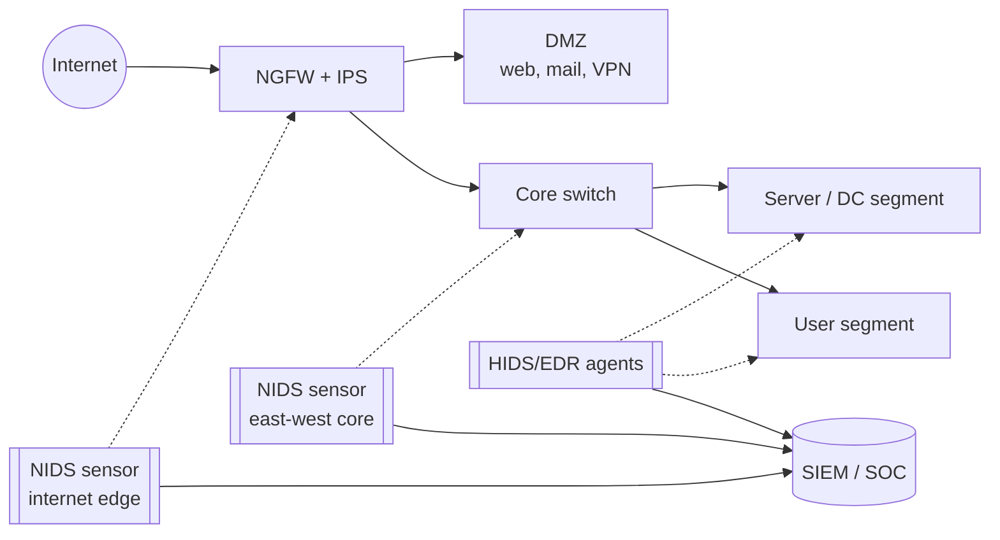
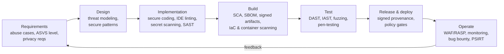

# Module 4 — Advanced Network and System Security

**Weeks 10–12** · Topics: Next-generation firewalls and intrusion detection systems · Secure software development practices · Container and microservices security

---

## Learning outcomes

By the end of this module you should be able to:

1. Compare packet-filtering, stateful, proxy and next-generation firewalls, and explain the trade-offs of TLS inspection.
2. Explain IDS/IPS architectures and detection methods, write and tune signature rules, and evaluate detection performance.
3. Describe a secure software development lifecycle (SSDLC) using NIST SSDF and OWASP SAMM, and place security tools (SAST, DAST, SCA, IAST, secret scanning) in a CI/CD pipeline.
4. Explain software supply-chain threats and controls (SBOM, SLSA, code signing).
5. Explain the Linux isolation primitives behind containers and their limits.
6. Harden container images, Kubernetes clusters and service-to-service communication in microservice architectures.

---

## 4.1 Firewalls: from packet filters to NGFW

### 4.1.1 Evolution

| Generation | Decision based on | Strengths | Weaknesses |
|------------|-------------------|-----------|-----------|
| Packet filter (stateless) | IPs, ports, protocol, per packet | Fast, simple (router ACLs) | No context; easily evaded; complex rule sets |
| Stateful inspection | Connection state table (e.g., TCP handshake) | Allows return traffic automatically; blocks unsolicited packets | Blind to application content |
| Application proxy / gateway | Terminates and re-originates connections at layer 7 | Deep protocol understanding | Performance; per-protocol proxies needed |
| **Next-generation firewall (NGFW)** | Application, user, content, threat intel, plus state | Policy by app and identity; integrated IPS; URL filtering; TLS inspection | Cost, complexity, performance impact when all features enabled |
| Web Application Firewall (WAF) | HTTP request/response semantics | Protects web apps from injection, XSS, bots | Requires tuning; bypasses common; not a substitute for secure code |
| FWaaS / SASE | Cloud-delivered firewall + SWG + ZTNA + CASB | Protects remote users and branches consistently | Dependency on provider; data-sovereignty questions |

### 4.1.2 Core NGFW capabilities

- **Application identification** — classify traffic as e.g. "Microsoft Teams" or "BitTorrent" regardless of port, using signatures, protocol decoders and heuristics.
- **User identity awareness** — map IPs to users via IdP/AD integration; rules like "Finance group may use the SAP app."
- **Integrated IPS** — signature and anomaly-based threat prevention inline.
- **TLS/SSL inspection** — decrypt, inspect and re-encrypt traffic.
- **URL filtering and DNS security**; **sandboxing** of unknown files; **threat-intelligence feeds** for IP/domain reputation.
- **Centralised management** and logging to SIEM.

### 4.1.3 TLS inspection — the trade-off

Over 90% of web traffic is encrypted, so without decryption the NGFW cannot see payloads.

| For | Against |
|-----|---------|
| Visibility of malware, C2 and data exfiltration in HTTPS | Breaks end-to-end encryption; firewall becomes a high-value target holding a trusted CA key |
| Enables DLP and sandboxing | Privacy and legal issues (banking, health, personal use) — requires policy, notice, exemptions |
| | Certificate pinning and mTLS apps break; TLS 1.3 + Encrypted Client Hello reduce passive visibility |
| | Significant performance cost |

Typical approach: decrypt selectively by category and risk, exempt sensitive categories (health, finance), and complement with **endpoint telemetry (EDR)** and metadata analysis (JA4 fingerprints, SNI, certificate data).

### 4.1.4 Firewall rule-base hygiene

- **Default deny** inbound and (increasingly) outbound.
- Order matters — most specific first; avoid shadowed and redundant rules.
- Every rule has an **owner, business justification, ticket reference and review date**.
- Remove "any-any" rules; log denies and critical allows.
- Regularly review with analyser tools; test changes in staging.
- Protect the **management plane** — dedicated management network, MFA, patched firmware. Edge devices are prime targets (many critical exploited vulnerabilities in VPN and firewall appliances 2023–2025).

---

## 4.2 Intrusion detection and prevention systems

### 4.2.1 Taxonomy

| Dimension | Options |
|-----------|---------|
| Placement | **NIDS** (network sensor, SPAN/TAP) · **HIDS** (agent on host: file integrity, log analysis, e.g., Wazuh/OSSEC) |
| Mode | **IDS** (passive, alerts) · **IPS** (inline, can drop/reset) |
| Detection method | **Signature/misuse-based** (known patterns) · **Anomaly-based** (deviation from baseline, statistical/ML) · **Specification/protocol-based** (violations of protocol RFCs/state machines) |
| Modern evolution | **NDR** (network detection & response: ML + metadata + response) · **EDR/XDR** (endpoint and cross-domain correlation) |

| | Signature-based | Anomaly-based |
|---|---|---|
| Detects | Known attacks | Novel attacks, insider misuse |
| False positives | Low (if well-tuned) | High |
| Explainability | High (rule matched) | Lower |
| Maintenance | Constant signature updates | Baseline retraining; drift |

### 4.2.2 Open-source tools

- **Snort** (Cisco; Snort 3) — signature-based IDS/IPS.
- **Suricata** (OISF) — multi-threaded IDS/IPS, protocol parsing, file extraction, EVE JSON logs; compatible with most Snort rules.
- **Zeek** (formerly Bro) — network security monitor producing rich protocol logs (`conn.log`, `dns.log`, `http.log`, `ssl.log`) and a scripting language for behaviour detection. Excellent for threat hunting.
- **Security Onion** — distribution bundling Suricata, Zeek, Elastic and analyst tools.

### 4.2.3 Anatomy of a Suricata rule

```
alert http $EXTERNAL_NET any -> $HOME_NET any (
    msg:"POLICY Possible Log4Shell JNDI lookup in HTTP header";
    flow:established,to_server;
    http.header; content:"${jndi:"; nocase;
    classtype:attempted-admin;
    reference:cve,2021-44228;
    sid:1000001; rev:1;
)
```

| Part | Meaning |
|------|---------|
| `alert` | Action (`alert`, `drop`, `reject`, `pass`) |
| `http` | Protocol / app-layer parser |
| `$EXTERNAL_NET any -> $HOME_NET any` | Source, source port, direction, destination, destination port |
| `flow:established,to_server` | Only client-to-server traffic in established sessions |
| `http.header; content:"${jndi:"; nocase` | Sticky buffer: match string in HTTP headers, case-insensitive |
| `sid`, `rev` | Unique rule ID (≥1,000,000 for local rules) and revision |

Note: attackers immediately obfuscated Log4Shell payloads (e.g., `${${lower:j}ndi:`), illustrating why **signatures alone are brittle** — combine with egress controls (block outbound LDAP/RMI) and patching.

### 4.2.4 Evaluating and tuning detection

- **Confusion matrix:** TP, FP, TN, FN; report precision, recall, and **false positives per day per analyst**.
- **Base-rate fallacy** (see Module 1) — even small FP rates overwhelm analysts.
- **Alert fatigue** leads to missed true positives (cf. Target 2013, where malware alerts were raised but not acted upon).
- **Tuning:** define `HOME_NET` correctly; disable irrelevant rules; thresholds and suppression; enrich with asset context.
- **Detection engineering** lifecycle: hypothesis → rule (e.g., **Sigma** for logs, Suricata/YARA for network/files) → test with simulated attacks (Atomic Red Team) → deploy → measure → retire. Track ATT&CK coverage.
- **Evasion techniques to know:** fragmentation and segment overlap, encoding/obfuscation, encryption, low-and-slow, protocol ambiguities (Ptacek & Newsham, 1998).

### 4.2.5 Where to place sensors



East–west monitoring is critical: lateral movement inside the network is where many attacks are caught — or missed.

---

## 4.3 Secure software development practices

### 4.3.1 Why

Most exploited vulnerabilities originate in software defects. Fixing a defect at design time is far cheaper than after release. CISA's **Secure by Design** initiative argues that vendors, not customers, should own security outcomes (e.g., memory-safe languages, eliminating default passwords, eliminating whole vulnerability classes).

### 4.3.2 Frameworks and maturity models

- **NIST SP 800-218 — Secure Software Development Framework (SSDF)**, four practice groups:
  - **PO** Prepare the Organization
  - **PS** Protect the Software (from tampering)
  - **PW** Produce Well-Secured Software
  - **RV** Respond to Vulnerabilities
- **OWASP SAMM v2** — five business functions: Governance, Design, Implementation, Verification, Operations; each with maturity levels 1–3.
- **BSIMM** — descriptive study of what real organisations actually do.
- **Microsoft SDL** — the classic prescriptive SSDLC.
- **OWASP ASVS** — Application Security Verification Standard: testable requirements at levels 1–3.

### 4.3.3 Security activities across the SDLC



| Tool type | What it does | When | Limitations |
|-----------|-------------|------|-------------|
| **SAST** (Semgrep, CodeQL, SonarQube) | Analyses source code for vulnerable patterns | Commit / PR | False positives; limited runtime context |
| **SCA** (Dependabot, OWASP Dependency-Check, Trivy, Grype) | Finds known-vulnerable third-party components | Build | Only known CVEs; reachability often unknown |
| **Secret scanning** (gitleaks, TruffleHog, platform push protection) | Detects credentials in code and history | Pre-commit / push | Must also rotate leaked secrets |
| **DAST** (OWASP ZAP, Burp Suite) | Tests running application from outside | Test / staging | Coverage of authenticated and complex flows |
| **IAST / RASP** | Instruments the running app | Test / production | Language/runtime-specific |
| **Fuzzing** (AFL++, libFuzzer, OSS-Fuzz) | Feeds malformed inputs to find crashes | Test / continuous | Needs harnesses; best for parsers |
| **IaC & container scanning** (Checkov, Trivy, KICS) | Detects misconfigurations and vulnerable packages in images | Build | Policy tuning |

### 4.3.4 OWASP Top 10 (web applications)

**2021 edition** (still widely referenced): A01 Broken Access Control · A02 Cryptographic Failures · A03 Injection · A04 Insecure Design · A05 Security Misconfiguration · A06 Vulnerable and Outdated Components · A07 Identification and Authentication Failures · A08 Software and Data Integrity Failures · A09 Security Logging and Monitoring Failures · A10 Server-Side Request Forgery.

**2025 edition:** Broken Access Control remains #1; Security Misconfiguration rises to #2; **Software Supply Chain Failures** (an expansion of *Vulnerable and Outdated Components*) and **Mishandling of Exceptional Conditions** are new categories; SSRF is merged into Broken Access Control. Read the current list on owasp.org and be able to compare editions.

### 4.3.5 Secure coding essentials

- **Input validation** (allow-lists) and **output encoding** by context (HTML, JS, URL, SQL).
- **Parameterised queries** — never build SQL by string concatenation:

```python
# Vulnerable
cur.execute(f"SELECT * FROM users WHERE email = '{email}'")
# Safe
cur.execute("SELECT * FROM users WHERE email = %s", (email,))
```

- **Authorisation checks on every request, server-side** (object-level — prevents IDOR / BOLA).
- **Use vetted libraries** for crypto, authentication, session management — never "roll your own."
- **Secrets management** (Vault, cloud secret managers); no secrets in code or images.
- **Memory-safe languages** (Rust, Go, Java, C#, Python) for new code where feasible; memory-safety bugs account for a large share of critical vulnerabilities in C/C++ codebases.
- **Fail securely**; avoid leaking stack traces; log security events without logging secrets or excessive personal data.

### 4.3.6 Software supply-chain security

| Incident | What happened | Lesson |
|----------|---------------|--------|
| **SolarWinds (2020)** | Build system compromised; malicious code inserted into signed Orion updates; ~18,000 customers received it | Protect and verify the **build pipeline**, not just source code |
| **Log4Shell (2021)** | Critical RCE in ubiquitous Java logging library | Need to know where components are used — **SBOM** |
| **Codecov (2021)** | Modified bash uploader script exfiltrated CI secrets | Pin and verify third-party scripts; limit CI secrets |
| **xz-utils (2024)** | Multi-year social-engineering takeover of a maintainer role; backdoor targeting SSH via release tarballs | Open-source maintainer burnout is a security risk; reproducible builds; verify release artifacts against source |

Controls:
- **SBOM** in **SPDX** or **CycloneDX** format, generated at build time (e.g., Syft) and consumed by vulnerability management; **VEX** statements to communicate exploitability.
- **SLSA** (Supply-chain Levels for Software Artifacts) — build-track levels for provenance and tamper-resistance of builds.
- **Artifact signing and verification** — Sigstore (`cosign`), in-toto attestations; verify at deploy time with admission policies.
- **Dependency hygiene** — pin versions and hashes (lockfiles), private mirrors, review new dependencies, watch for typosquatting and dependency confusion.
- **Harden CI/CD** — least-privilege tokens, ephemeral runners, OIDC instead of static secrets, branch protection, mandatory code review.

---

## 4.4 Container and microservices security

### 4.4.1 How containers isolate (and where they don't)

Containers are **processes** sharing the host kernel, isolated by Linux features:

| Mechanism | Purpose |
|-----------|---------|
| **Namespaces** (pid, net, mnt, uts, ipc, user, cgroup) | Each container sees its own processes, network stack, filesystem, hostname |
| **cgroups** | Limit CPU, memory, I/O — prevents resource-exhaustion DoS |
| **Capabilities** | Split root's power into units (e.g., `CAP_NET_ADMIN`); drop all that are not needed |
| **seccomp** | Filter allowed system calls |
| **LSMs: AppArmor / SELinux** | Mandatory access control profiles |
| **Read-only root filesystem, user namespaces / rootless** | Limit persistence and root-in-container = root-on-host risk |

Because the kernel is shared, a **kernel vulnerability or misconfiguration can lead to container escape** (e.g., `--privileged`, mounting `/var/run/docker.sock`, host path mounts, CVE-2019-5736 runc, CVE-2024-21626 "Leaky Vessels"). For stronger isolation use **sandboxed runtimes** (gVisor) or **micro-VMs** (Kata Containers, Firecracker).

### 4.4.2 The container security lifecycle

**Build**
- Minimal base images (distroless, Alpine, scratch, Chainguard/Wolfi-style images) → fewer vulnerabilities
- Multi-stage builds; no compilers or secrets in final image
- Run as **non-root** user; pin base images by **digest**
- Scan images (Trivy, Grype); generate SBOM; sign images (cosign)

```dockerfile
FROM golang:1.23 AS build
WORKDIR /src
COPY . .
RUN CGO_ENABLED=0 go build -o /app ./cmd/server

FROM gcr.io/distroless/static-debian12:nonroot
COPY --from=build /app /app
USER nonroot:nonroot
ENTRYPOINT ["/app"]
```

**Ship**
- Private registry with access control; admission policy that only allows **signed, scanned** images from trusted registries (Kyverno, OPA Gatekeeper, Sigstore policy-controller)

**Run**
- Runtime threat detection (**Falco**, eBPF-based tools such as Tetragon) — e.g., alert on shell spawned in container, unexpected outbound connections, writes to `/etc`
- Drift detection: containers should be immutable

### 4.4.3 Kubernetes security

**4C model:** Cloud → Cluster → Container → Code — each layer depends on the one beneath it.

| Area | Controls |
|------|----------|
| **API server & control plane** | Not exposed to the internet; strong authentication (OIDC); audit logging enabled; etcd encrypted at rest and access-restricted; keep version supported and patched |
| **RBAC** | Least-privilege Roles; avoid `cluster-admin`; avoid wildcard verbs/resources; dedicated ServiceAccounts per workload; `automountServiceAccountToken: false` where not needed |
| **Pod Security Standards** | Enforce **Restricted** (or at least **Baseline**) via Pod Security Admission namespace labels; block privileged pods, hostPath, hostNetwork, root users |
| **Network Policies** | **Default-deny** ingress and egress per namespace; explicitly allow required flows (requires a CNI that enforces policies, e.g., Calico, Cilium) |
| **Secrets** | Kubernetes Secrets are only base64-encoded — enable encryption at rest (KMS provider); prefer external secret stores; restrict RBAC on `secrets` |
| **Supply chain** | Admission control for image signatures and registries |
| **Nodes** | Hardened, minimal OS; CIS Kubernetes Benchmark (check with `kube-bench`); restrict kubelet API |
| **Monitoring** | Audit logs to SIEM; runtime detection; posture scanning (Kubescape, Trivy operator) |

**Hardened pod example:**

```yaml
apiVersion: v1
kind: Namespace
metadata:
  name: payments
  labels:
    pod-security.kubernetes.io/enforce: restricted
---
apiVersion: apps/v1
kind: Deployment
metadata:
  name: api
  namespace: payments
spec:
  replicas: 2
  selector: { matchLabels: { app: api } }
  template:
    metadata: { labels: { app: api } }
    spec:
      automountServiceAccountToken: false
      securityContext:
        runAsNonRoot: true
        seccompProfile: { type: RuntimeDefault }
      containers:
        - name: api
          image: registry.example.com/payments/api@sha256:<digest>
          securityContext:
            allowPrivilegeEscalation: false
            readOnlyRootFilesystem: true
            capabilities: { drop: ["ALL"] }
          resources:
            limits: { cpu: "500m", memory: "256Mi" }
```

**Default-deny NetworkPolicy:**

```yaml
apiVersion: networking.k8s.io/v1
kind: NetworkPolicy
metadata:
  name: default-deny-all
  namespace: payments
spec:
  podSelector: {}
  policyTypes: ["Ingress", "Egress"]
```

**Case study — Tesla (2018):** attackers found a Kubernetes console **without password protection**, obtained cloud credentials stored in a pod, and ran **cryptomining** that hid behind a CDN and throttled CPU to avoid detection. Lessons: authenticate all management interfaces; no cloud credentials in pods (use workload identity); monitor resource usage and egress.

### 4.4.4 Microservices security

Microservices multiply the number of network-exposed components and inter-service calls.

| Challenge | Control |
|-----------|---------|
| Many service-to-service calls over the network | **mTLS** everywhere — typically via a **service mesh** (Istio, Linkerd) providing workload identity (SPIFFE/SPIRE), encryption and authorisation policies |
| Authentication of end users across services | **API gateway** validates tokens (OAuth 2.0 / OIDC); propagate identity with short-lived, audience-restricted **JWTs**; validate signature, `aud`, `iss`, `exp` in each service |
| Authorisation | Centralised policy engine (OPA, Cedar) with decisions enforced in each service; check object-level authorisation (OWASP **API Security Top 10** — BOLA is #1) |
| Large attack surface of APIs | Inventory all APIs (including "shadow" and "zombie" APIs); schema validation; rate limiting |
| Secrets sprawl | Central secrets manager; dynamic short-lived credentials |
| Observability | Distributed tracing, centralised logs with correlation IDs; security analytics on API calls |
| Cascading failures / DoS | Timeouts, circuit breakers, bulkheads, quotas |

---

## 4.5 Lab exercises

### Lab 4A — IDS rules against a PCAP (Week 10)
1. Run Suricata on a sample malware-traffic PCAP (e.g., from malware-traffic-analysis.net — handle samples in an isolated VM).
2. Review `eve.json` alerts with `jq`.
3. Run Zeek on the same PCAP; find the C2 domain from `dns.log` and `ssl.log`.
4. Write one custom Suricata rule and one Zeek or Sigma detection for the behaviour you found. Report TP/FP on a clean traffic sample.

### Lab 4B — Secure CI pipeline (Week 11)
Fork a deliberately vulnerable app (e.g., OWASP Juice Shop or a small Flask app provided). Add a GitHub Actions / GitLab CI pipeline that runs: secret scanning (gitleaks), SAST (Semgrep), SCA (Trivy or Dependency-Check), SBOM generation (Syft), DAST baseline (OWASP ZAP). Fail the build on critical findings. Fix two vulnerabilities and show the pipeline going green.

### Lab 4C — Harden a Kubernetes workload (Week 12)
1. Create a local cluster with `kind` (using a policy-enforcing CNI such as Calico).
2. Deploy the provided insecure manifest (root, privileged, hostPath, no limits).
3. Run `kube-bench` and `kubescape`; record findings.
4. Apply Pod Security Admission `restricted`, a default-deny NetworkPolicy plus specific allows, and a hardened securityContext.
5. Install Falco and trigger an alert by running `kubectl exec ... -- sh`.

---

## 4.6 Discussion questions

1. With TLS 1.3 and Encrypted Client Hello, is network-based inspection becoming obsolete? What replaces it?
2. Should organisations block deployment on any critical SCA finding? Discuss reachability, VEX and developer friction.
3. Containers vs. virtual machines: when is container isolation not sufficient?
4. Who is responsible for open-source security — maintainers, consumers, or governments?

---

## 4.7 Self-check quiz

1. What two capabilities most distinguish an NGFW from a stateful firewall?
2. What is the difference between an IDS and an IPS?
3. Give one strength and one weakness of anomaly-based detection.
4. In a Suricata rule, what does `sid` represent?
5. Name the four practice groups of NIST SSDF.
6. What is the difference between SAST and DAST?
7. What is an SBOM, and name two standard formats.
8. Which Linux features provide container isolation?
9. What are the three Kubernetes Pod Security Standards levels?
10. Why are Kubernetes Secrets not secure by default?

<details>
<summary><strong>Answers</strong></summary>

1. Application awareness (identifying apps regardless of port) and user-identity awareness — plus integrated IPS and TLS inspection.
2. An IDS passively monitors and alerts; an IPS sits inline and can block or drop malicious traffic.
3. Strength: can detect novel/zero-day or insider behaviour. Weakness: high false-positive rate and lower explainability.
4. The unique signature ID of the rule.
5. Prepare the Organization (PO), Protect the Software (PS), Produce Well-Secured Software (PW), Respond to Vulnerabilities (RV).
6. SAST analyses source code without running it (white-box); DAST tests the running application from the outside (black-box).
7. A Software Bill of Materials — a formal inventory of components and dependencies in software. Formats: SPDX and CycloneDX.
8. Namespaces, cgroups, capabilities, seccomp, and LSMs (AppArmor/SELinux).
9. Privileged, Baseline, Restricted.
10. They are only base64-encoded and stored in etcd unencrypted unless encryption at rest is configured, and anyone with RBAC read access to Secrets (or who can create pods mounting them) can read them.

</details>

---

## Further reading

- NIST SP 800-41 Rev. 1 (firewalls); SP 800-94 (IDPS)
- Ptacek, T. & Newsham, T. (1998). *Insertion, Evasion, and Denial of Service: Eluding Network Intrusion Detection.*
- Suricata documentation — https://docs.suricata.io · Zeek documentation — https://docs.zeek.org
- NIST SP 800-218 (SSDF); OWASP SAMM v2; OWASP ASVS; OWASP Top 10 and API Security Top 10
- CISA, *Secure by Design* principles
- SLSA specification — https://slsa.dev; CycloneDX and SPDX specifications
- NIST SP 800-190, *Application Container Security Guide*; SP 800-204 series (microservices)
- CIS Docker and Kubernetes Benchmarks; NSA/CISA *Kubernetes Hardening Guide*
