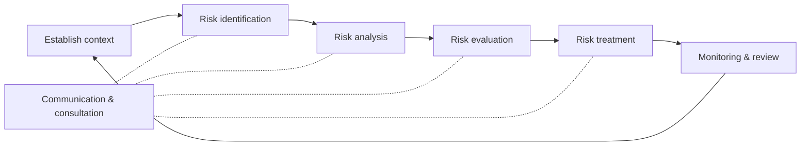
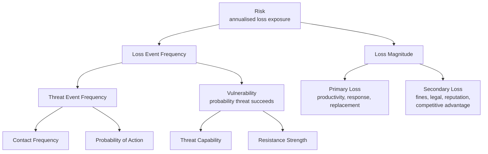
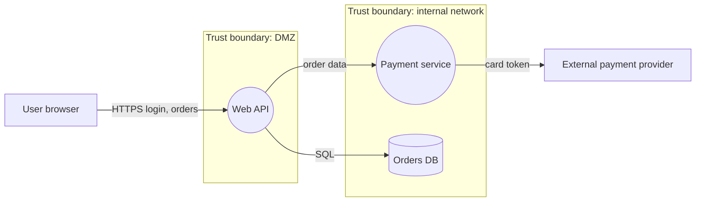
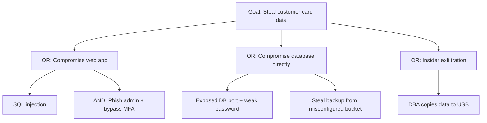
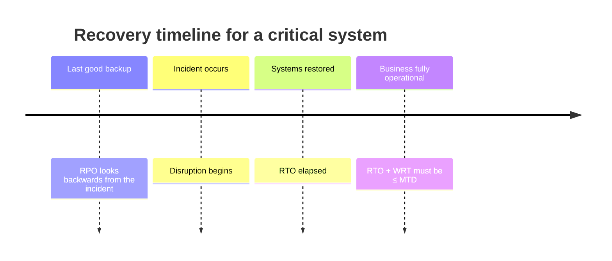

# Module 5 — Cybersecurity Risk Management

**Weeks 13–14** · Topics: Advanced risk assessment methodologies · Threat modeling techniques · Business continuity and disaster recovery planning

---

## Learning outcomes

By the end of this module you should be able to:

1. Define risk and its components, and explain risk appetite, tolerance, inherent and residual risk.
2. Compare qualitative, semi-quantitative and quantitative risk assessment, and apply NIST SP 800-30, ISO/IEC 27005 and FAIR.
3. Compute ALE and run a simple Monte Carlo FAIR analysis, and communicate results to executives.
4. Build a threat model with data-flow diagrams and STRIDE, and explain PASTA, LINDDUN, attack trees and ATT&CK-based approaches.
5. Conduct a Business Impact Analysis and derive RTO, RPO and MTD.
6. Design BC/DR strategies (including ransomware resilience) and plan exercises to test them.

---

## 5.1 Risk fundamentals

**Risk** (ISO 31000) is the *effect of uncertainty on objectives*. In cybersecurity it is commonly expressed as:

> **Risk = Likelihood (of a threat event exploiting a vulnerability) × Impact (on the organisation)**

| Term | Meaning |
|------|---------|
| **Asset** | Anything of value — data, systems, people, reputation |
| **Threat** | Potential cause of an unwanted incident (actor + action) |
| **Vulnerability** | Weakness that can be exploited |
| **Control** | Measure that modifies risk |
| **Inherent risk** | Risk before controls |
| **Residual risk** | Risk remaining after controls |
| **Risk appetite** | Amount and type of risk an organisation is *willing to pursue or retain* (strategic, set by the board) |
| **Risk tolerance** | Acceptable *variation* around objectives / thresholds for specific risks (operational) |
| **Risk owner** | Person accountable for managing a risk — usually a business leader, not the security team |

**Risk treatment options:**

| Option | Description | Cyber example |
|--------|-------------|---------------|
| **Mitigate / modify** | Apply controls to reduce likelihood or impact | MFA, segmentation, backups |
| **Transfer / share** | Shift financial impact to a third party | Cyber insurance, outsourcing with contractual liability |
| **Avoid** | Stop the risky activity | Decommission an internet-facing legacy app |
| **Accept / retain** | Consciously accept, documented and approved by the risk owner | Low-impact risk below appetite |

### 5.1.1 Risk management frameworks

- **ISO 31000:2018** — generic enterprise risk management principles, framework and process.
- **ISO/IEC 27005:2022** — information security risk management; supports ISO 27001. Describes both *event-based* (scenarios) and *asset-based* identification.
- **NIST SP 800-30 Rev. 1** — *Guide for Conducting Risk Assessments*: prepare → conduct (identify threat sources and events, vulnerabilities, likelihood, impact, determine risk) → communicate → maintain.
- **NIST SP 800-37 Rev. 2 — Risk Management Framework (RMF)**: Prepare, Categorize, Select, Implement, Assess, Authorize, Monitor — used for US federal systems with SP 800-53 controls.
- **NIST IR 8286** series — integrating cybersecurity risk into enterprise risk management (ERM) with **risk registers**.
- **FAIR** (Factor Analysis of Information Risk) — Open Group standard (O-RA / O-RT) for quantitative risk.
- **OCTAVE** (CMU SEI) — self-directed, operational-risk-focused methodology (OCTAVE Allegro for smaller teams).



---

## 5.2 Advanced risk assessment methodologies

### 5.2.1 Qualitative assessment and its limits

The familiar **5×5 heat map** rates likelihood and impact from 1 (very low) to 5 (very high):

| Likelihood ↓ / Impact → | 1 | 2 | 3 | 4 | 5 |
|---|:-:|:-:|:-:|:-:|:-:|
| **5** | M | H | H | C | C |
| **4** | M | M | H | H | C |
| **3** | L | M | M | H | H |
| **2** | L | L | M | M | H |
| **1** | L | L | L | M | M |

**Advantages:** fast, intuitive, good for workshops and initial prioritisation.
**Criticisms** (Hubbard & Seiersen; Cox, "What's Wrong with Risk Matrices?" 2008):
- Ordinal scales are not numbers — multiplying "3 × 4" has no mathematical meaning.
- **Range compression** — very different risks land in the same cell.
- Ambiguous words ("likely") are interpreted very differently by different people.
- Cannot aggregate risks or compare against the cost of controls.

### 5.2.2 Classical quantitative assessment (ALE)

| Formula | Meaning |
|---------|---------|
| **SLE = AV × EF** | Single Loss Expectancy = Asset Value × Exposure Factor (fraction of value lost per incident) |
| **ALE = SLE × ARO** | Annualised Loss Expectancy = SLE × Annualised Rate of Occurrence |
| **Control value = ALE(before) − ALE(after) − annual cost of control** | Positive → control is cost-justified |

**Worked example.** A customer database is valued at £2,000,000 (including breach response, fines, lost business). A ransomware incident would destroy 40% of its value (EF = 0.4). Historical data suggests one such event every 4 years (ARO = 0.25).

- SLE = 2,000,000 × 0.4 = **£800,000**
- ALE = 800,000 × 0.25 = **£200,000/year**

A proposed control set (immutable backups + EDR) costs £60,000/year and is expected to reduce ARO to 0.1 and EF to 0.15:

- New SLE = 2,000,000 × 0.15 = £300,000; new ALE = 300,000 × 0.1 = **£30,000**
- Value = 200,000 − 30,000 − 60,000 = **£110,000/year → justified**

**Limitation:** single-point estimates hide uncertainty. That leads to FAIR and Monte Carlo.

### 5.2.3 FAIR — Factor Analysis of Information Risk

FAIR decomposes risk into measurable factors and models each as a **range** (min / most likely / max) with a confidence level.



- **LEF = TEF × Vulnerability**
- **Risk (annual loss exposure) ≈ LEF × LM**, computed by simulation.
- Six forms of loss: productivity, response, replacement, fines & judgments, competitive advantage, reputation.

**Calibrated estimation.** Experts give 90% confidence intervals; calibration training (Hubbard) improves their accuracy. Use external data (industry breach reports, insurance claims) to anchor estimates.

**Monte Carlo example** (Python):

```python
import numpy as np
rng = np.random.default_rng(42)
N = 100_000

# Loss Event Frequency per year (min, most likely, max)
lef = rng.triangular(0.05, 0.2, 0.6, N)
# Loss magnitude per event in GBP — lognormal is typical for heavy-tailed losses
lm = rng.lognormal(mean=np.log(400_000), sigma=0.9, size=N)

# Number of events per simulated year, then total annual loss
events = rng.poisson(lef)
annual_loss = lm * events

print(f"Mean annual loss:  £{annual_loss.mean():,.0f}")
print(f"P(loss > £0):      {np.mean(annual_loss > 0):.1%}")
print(f"90th percentile:   £{np.percentile(annual_loss, 90):,.0f}")
print(f"99th percentile:   £{np.percentile(annual_loss, 99):,.0f}")
```

(This simplification uses one magnitude draw per year; a fuller model draws a separate magnitude for each event.)

Present results as a **loss exceedance curve** — probability that annual loss exceeds £X — and compare it with the organisation's **risk tolerance curve**. This lets executives answer: "Is this risk within appetite?" and "Which control buys the most risk reduction per pound?"

### 5.2.4 Choosing a method

| Method | Best for | Watch out for |
|--------|----------|---------------|
| Qualitative heat map | Quick triage, low-maturity organisations, workshops | False precision; inconsistent ratings |
| Semi-quantitative (scored scales with defined numeric ranges) | Consistent prioritisation in a risk register | Still ordinal arithmetic |
| ALE | Teaching, simple cost-benefit | Point estimates ignore uncertainty |
| FAIR / Monte Carlo | Board reporting, investment decisions, cyber insurance | Needs data, tools and training; "garbage in, garbage out" |
| Scenario-based / threat-informed | Linking risk to real adversary behaviour (ATT&CK) | Coverage of all scenarios |

### 5.2.5 Third-party and supply-chain risk

Modern risk assessment must include suppliers: tier vendors by criticality and data access; use questionnaires (e.g., SIG, CAIQ), certifications (ISO 27001, SOC 2 Type II), continuous external monitoring, contractual security clauses and right to audit; plan for **concentration risk** (e.g., the July 2024 CrowdStrike faulty update that crashed ~8.5 million Windows hosts worldwide — a non-malicious incident with massive impact).

---

## 5.3 Threat modeling techniques

Threat modeling is a structured way of answering the four questions of the **Threat Modeling Manifesto** (Shostack):

1. **What are we working on?** (model the system)
2. **What can go wrong?** (identify threats)
3. **What are we going to do about it?** (mitigate)
4. **Did we do a good enough job?** (validate)

It is most valuable during **design**, and should be revisited when architecture changes.

### 5.3.1 Modelling the system — Data Flow Diagrams (DFDs)

DFD elements: **external entity** (rectangle), **process** (circle), **data store** (parallel lines), **data flow** (arrow) and **trust boundary** (dashed line) — threats concentrate where data crosses trust boundaries.



### 5.3.2 STRIDE (Microsoft)

| Threat | Violated property | Example | Typical mitigation |
|--------|------------------|---------|--------------------|
| **S**poofing | Authentication | Stolen session cookie used to impersonate user | MFA, secure session management, mTLS |
| **T**ampering | Integrity | Modifying order price in a request | Server-side validation, signatures/MACs |
| **R**epudiation | Non-repudiation | User denies placing an order; no logs | Tamper-evident audit logging |
| **I**nformation disclosure | Confidentiality | SQL injection dumps the DB | Parameterised queries, encryption, least privilege |
| **D**enial of service | Availability | API flooded with requests | Rate limiting, autoscaling, CDN/WAF |
| **E**levation of privilege | Authorisation | Normal user calls admin endpoint | Server-side authorisation checks, RBAC |

**STRIDE-per-element:** apply only the relevant categories to each DFD element type (e.g., data stores are subject to T, I, D — and R if they hold logs; external entities to S and R).

### 5.3.3 Other techniques

| Technique | Focus | Key points |
|-----------|-------|-----------|
| **PASTA** (Process for Attack Simulation and Threat Analysis) | Risk-centric, business-aligned | 7 stages: (1) define business objectives, (2) define technical scope, (3) decompose application, (4) threat analysis, (5) vulnerability & weakness analysis, (6) attack modeling, (7) risk & impact analysis |
| **LINDDUN** | Privacy threats | Linking, Identifying, Non-repudiation, Detecting, Data disclosure, Unawareness, Non-compliance — pairs well with GDPR DPIAs |
| **Attack trees** (Schneier, 1999) | Attacker goals decomposed into AND/OR sub-goals | Annotate leaves with cost, skill, likelihood; find cheapest attack path |
| **MITRE ATT&CK-based / threat-informed defence** | Real adversary TTPs | Choose relevant threat groups; map techniques to controls and detections; find gaps |
| **Kill-chain analysis** | Sequence of attack stages | Identify where to break the chain |
| **DREAD** | Scoring (Damage, Reproducibility, Exploitability, Affected users, Discoverability) | Largely abandoned by Microsoft due to subjectivity; know it historically |
| **CVSS v4.0** | Vulnerability severity scoring | Severity ≠ risk; combine with exploit likelihood (**EPSS**) and **CISA KEV** catalogue |
| **Trike, VAST, hTMM** | Other approaches | Know they exist |

### 5.3.4 Attack tree example



### 5.3.5 Integrating threat modeling into development

- Lightweight models per feature/epic in agile teams ("threat model every story that crosses a trust boundary").
- Store models as code (e.g., OWASP **Threat Dragon**, **pytm**, Threagile) alongside source.
- Turn each mitigation into a backlog item with acceptance criteria; turn each threat into a test case.
- Use *Elevation of Privilege* card game for training developers.

---

## 5.4 Business continuity and disaster recovery

### 5.4.1 Definitions

| Term | Meaning |
|------|---------|
| **Business Continuity (BC)** | Ability to continue delivering products/services at acceptable levels during disruption (ISO 22301) |
| **Disaster Recovery (DR)** | Subset of BC focused on restoring IT systems and data |
| **Incident Response (IR)** | Detecting, containing and eradicating a security incident — often triggers BC/DR |
| **Crisis management** | Strategic leadership, decision-making and communications during a major event |

Standards: **ISO 22301:2019** (BCMS requirements, certifiable), **ISO/IEC 27031** (ICT readiness for business continuity), **NIST SP 800-34 Rev. 1** (contingency planning for federal systems), **NIST SP 800-184** (cybersecurity event recovery), and ISO 27001 Annex A **5.29–5.30**.

### 5.4.2 Business Impact Analysis (BIA)

The BIA identifies critical business functions, their dependencies, and how impact grows over time.

| Metric | Definition |
|--------|-----------|
| **MTD / MTPD** (Maximum Tolerable (Period of) Downtime) | Longest time a function can be unavailable before the organisation suffers unacceptable consequences |
| **RTO** (Recovery Time Objective) | Target time to restore a system/process after disruption — must be **less than MTD** |
| **WRT** (Work Recovery Time) | Time after systems are restored to verify data, catch up on backlog and resume work — **RTO + WRT ≤ MTD** |
| **RPO** (Recovery Point Objective) | Maximum acceptable data loss, measured in time (e.g., RPO 15 min → backups/replication at least every 15 min) |
| **MBCO** (Minimum Business Continuity Objective) | Minimum acceptable service level during disruption |



**Worked BIA extract (online retailer):**

| Business function | Impact after 1 h | 8 h | 24 h | MTD | RTO | RPO | Dependencies |
|-------------------|------------------|-----|------|-----|-----|-----|--------------|
| Online ordering | £50k revenue loss | £400k + customer churn | Regulatory and reputational damage | 8 h | 2 h | 5 min | Web tier, payments API, orders DB, IdP, DNS/CDN |
| Warehouse dispatch | Minor delay | SLA penalties | Significant penalties | 24 h | 8 h | 1 h | WMS, label printers, carrier APIs |
| Payroll | None | None | Minor | 5 days | 72 h | 24 h | SaaS payroll provider |

### 5.4.3 Recovery strategies

| Strategy | Description | Typical RTO | Cost |
|----------|-------------|-------------|------|
| **Backup & restore** | Restore from backups to new infrastructure | Hours–days | Low |
| **Cold site** | Space and power, no ready hardware | Days–weeks | Low |
| **Warm site / pilot light** | Core infrastructure running at minimum; scale up on failover | Hours | Medium |
| **Hot site / warm standby** | Fully provisioned replica, data replicated | Minutes–hours | High |
| **Active-active (multi-site / multi-region)** | Load shared across sites; failure absorbed | Near zero | Highest |

Cloud makes pilot-light and multi-region designs far cheaper, but you must still test failover and avoid shared failure domains (same identity provider, same account, same DNS).

### 5.4.4 Ransomware resilience

Ransomware changes classic DR assumptions: the attacker deliberately targets **backups**, **hypervisors** and **identity infrastructure**.

- **3-2-1-1-0 rule:** 3 copies of data, on 2 different media, 1 off-site, **1 immutable or offline (air-gapped)**, **0** errors after verified restore tests.
- Separate backup credentials and administrative domain; MFA on backup consoles; backup account isolation in the cloud (object lock / immutable vaults).
- **Clean-room recovery** — rebuild in an isolated environment; scan restored data for persistence before reconnecting.
- Prioritise recovery of **identity (AD/Entra ID)**, DNS and core network first — nothing else works without them.
- Plan for **extended outages** (weeks): manual workarounds, paper processes, out-of-band communications (attackers may be reading email and chat).
- Pre-agreed decisions: who decides on paying a ransom (legal, sanctions checks — e.g., OFAC/OFSI), insurance notification, law-enforcement engagement, regulators.

**Case studies:** *Maersk / NotPetya (2017)* — near-total global IT loss; recovery hinged on a single domain controller in Ghana that was offline due to a power cut. *Change Healthcare (2024)* — attacker entered via a remote-access portal without MFA; months-long disruption to US healthcare payments; the parent company reported costs in the billions of dollars. *British Library (2023)* — Rhysida ransomware; months-long outage; its published lessons-learned report is excellent reading on legacy infrastructure.

### 5.4.5 BCP structure

1. Purpose, scope and assumptions
2. Roles and responsibilities (crisis management team, recovery teams, deputies), call trees
3. Activation criteria and escalation
4. Recovery procedures per critical function (in priority order from BIA)
5. Communications plan — staff, customers, regulators, media, suppliers; pre-drafted templates
6. Resource requirements — alternate sites, equipment, suppliers, emergency funds
7. Return-to-normal procedures
8. Testing, training and maintenance schedule

### 5.4.6 Testing and exercising

| Exercise type | Description | Disruption |
|---------------|-------------|-----------|
| **Checklist / desk review** | Review plan for completeness and currency | None |
| **Walkthrough** | Team steps through the plan together | None |
| **Tabletop exercise** | Facilitated discussion of a realistic scenario with injects | None |
| **Simulation / functional exercise** | Practise specific functions (e.g., restore a system, activate call tree) | Low |
| **Parallel test** | Recover at the alternate site while production continues | Low–medium |
| **Full interruption test** | Shut down primary and run on alternate | High — rarely done, needs executive approval |

After every exercise or real incident: **after-action review**, update the plan, track corrective actions. Keep plans current with every major architecture change.

---

## 5.5 Lab exercises

### Lab 5A — STRIDE threat model (Week 13)
For the provided "university course-registration system" architecture: draw a DFD with trust boundaries (Threat Dragon or draw.io), apply STRIDE-per-element, identify at least 12 threats, rate them (CVSS-style or FAIR-lite), and propose mitigations. Add a LINDDUN pass for student personal data.

### Lab 5B — FAIR Monte Carlo (Week 13)
Using the Python template in §5.2.3, model the risk of a ransomware event for a 500-employee manufacturer. Justify each estimate with a source. Model the effect of two control investments, plot loss exceedance curves for each, and write a one-page recommendation to the CFO.

### Lab 5C — Ransomware tabletop exercise (Week 14)
In groups, play the roles of CEO, CIO, CISO, Legal/DPO, Communications and Operations. The facilitator releases injects (encrypted file servers → leak-site post → regulator inquiry → backup found compromised → media call). Produce: decision log, notification decisions (GDPR Art. 33/34, NIS2), recovery priorities using the BIA, and an after-action report with five improvements.

---

## 5.6 Discussion questions

1. "Risk heat maps are worse than useless." Do you agree? When might they still be appropriate?
2. Should a CISO own cyber risk? Who should be the risk owner, and why?
3. How should threat modeling adapt for AI-enabled applications (LLM agents with tool access)?
4. Paying a ransom may be the fastest path to recovery. What legal, ethical and practical factors should the board weigh?

---

## 5.7 Self-check quiz

1. Distinguish risk appetite from risk tolerance.
2. Asset value £500,000, exposure factor 0.3, ARO 0.5. What are SLE and ALE?
3. In FAIR, Loss Event Frequency is the product of which two factors?
4. Name the six STRIDE categories and the property each violates.
5. What is a trust boundary, and why does it matter in threat modeling?
6. What privacy threat-modeling methodology complements STRIDE?
7. Define RTO, RPO and MTD. What relationship must hold between RTO, WRT and MTD?
8. What does the "1" and the "0" add to the classic 3-2-1 backup rule?
9. Why should identity infrastructure be among the first systems recovered after ransomware?
10. Rank these exercises from least to most disruptive: parallel test, tabletop, full interruption, walkthrough.

<details>
<summary><strong>Answers</strong></summary>

1. Appetite is the overall amount and type of risk the organisation is willing to pursue or retain (strategic); tolerance is the acceptable deviation or specific thresholds for individual risks or objectives (operational).
2. SLE = 500,000 × 0.3 = £150,000; ALE = 150,000 × 0.5 = £75,000 per year.
3. Threat Event Frequency × Vulnerability (probability that a threat event becomes a loss event).
4. Spoofing–authentication; Tampering–integrity; Repudiation–non-repudiation; Information disclosure–confidentiality; Denial of service–availability; Elevation of privilege–authorisation.
5. A boundary where the level of trust changes (e.g., internet → DMZ, user → kernel, service → third-party). Data crossing it must be authenticated, validated and authorised, so threats concentrate there.
6. LINDDUN.
7. RTO: target time to restore a system after disruption. RPO: maximum tolerable data loss measured in time. MTD: maximum time a business function can be down before unacceptable consequences. RTO + WRT ≤ MTD.
8. "1" — at least one copy immutable or offline/air-gapped; "0" — zero errors, verified through restore testing.
9. Almost every other system depends on authentication and authorisation; attackers commonly compromise identity systems, so they must be rebuilt/verified clean first to avoid reinfection.
10. Walkthrough → tabletop → parallel test → full interruption.

</details>

---

## Further reading

- ISO 31000:2018; ISO/IEC 27005:2022; NIST SP 800-30 Rev. 1; NIST SP 800-37 Rev. 2; NIST IR 8286
- Freund, J. & Jones, J. (2014). *Measuring and Managing Information Risk: A FAIR Approach.* Butterworth-Heinemann.
- Hubbard, D. & Seiersen, R. (2023). *How to Measure Anything in Cybersecurity Risk*, 2nd ed. Wiley.
- Cox, L. A. (2008). "What's Wrong with Risk Matrices?" *Risk Analysis*, 28(2).
- Shostack, A. (2014). *Threat Modeling: Designing for Security.* Wiley; Threat Modeling Manifesto — https://www.threatmodelingmanifesto.org
- UcedaVélez, T. & Morana, M. (2015). *Risk Centric Threat Modeling: Process for Attack Simulation and Threat Analysis.* Wiley.
- LINDDUN — https://linddun.org
- ISO 22301:2019; NIST SP 800-34 Rev. 1; NIST SP 800-184
- British Library (2024). *Learning Lessons from the Cyber-Attack.*
